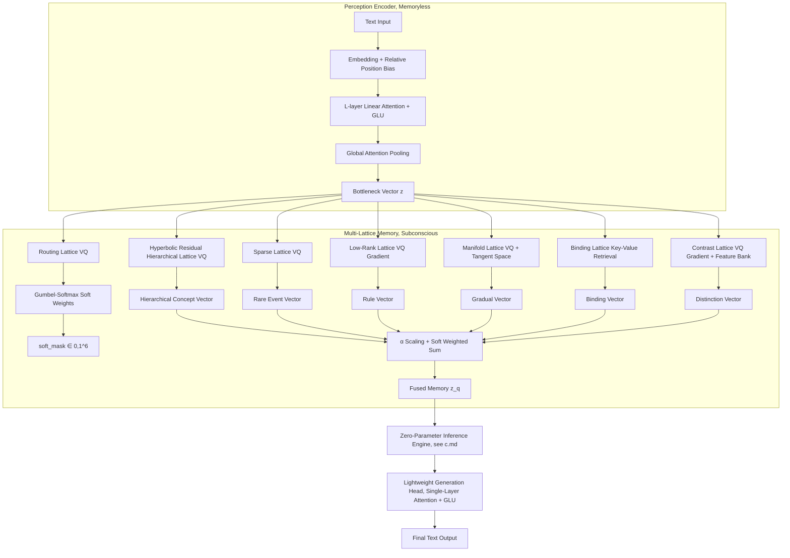

# Lattice Cognitive Model (LCM) Technical Specification and Implementation Guide v3.1-conformance

> **v3.1-conformance changelog**：本版按 `docs/superpowers/specs/2026-11-20-lattice-spec-conformance-design.md`
> 的 R1–R22 修订。中文版与英文版同步。

> **Version Notes**: This technical document provides a comprehensive mathematical refinement of the core modules of the "Lattice Cognitive Model (LCM)" project book, covering complete engineering implementation details from discrete memory lattices, generation head, to training losses. v3.0 completely rewrites the codebook update mechanism (hybrid EMA/gradient management), the binding lattice unbinding method (conjugate multiplication), routing gating (Gumbel-Softmax), contrast lattice collapse prevention (feature bank), low-rank lattice parameterization (pure gradient), and linear attention normalization, abolishes the FSP module, and separates the inference process into an independent zero-parameter inference engine (see c.md). **v4.0 new**: Generation head (single-layer linear attention+GLU) replaced by **Frozen LLM** — a complete LCM instance structurally identical to the Cognitive LCM, with codebooks storing semantic-syntactic primitives, constructing linguistic expressions via retrieval and fusion.

---

## 1. Notation and Global Conventions

| Symbol | Meaning | Recommended Value (all configurable) |
|------|------|--------|
| `B` | Batch size | 16 |
| `N` | Sequence length | 512 |
| `d` | Hidden/bottleneck dimension | 256 |
| `H` | Number of attention heads | 4 |
| `d_h` | Dimension per head `d/H` | 64 |
| `n_layers` | Number of residual quantization layers per lattice | 3 |
| `M_top` | Number of top-level prototypes in hyperbolic residual hierarchical lattice | 64 |
| `M_fine` | Bottom-level codebook size in hyperbolic residual hierarchical lattice | 64 |
| `M_sparse` | Sparse lattice codebook size | 512 |
| `M_lr` | Low-rank lattice codebook size | 1024 |
| `M_man` | Manifold lattice codebook size | 512 |
| `M_bind` | Binding lattice sub-codebook size | 512 |
| `M_contrast` | Contrast lattice codebook size | 512 |
| `M_route` | Routing lattice codebook size | 6 |
| `r_max` | Maximum rank for low-rank lattice | 8 |
| `r_k` | Rank sequence for layer k of low-rank lattice | `[2, 4, 8]` |
| `t` | Manifold lattice tangent space dimension | 4 |
| `γ_prod` | Product-correlation EMA decay rate | 0.999 |
| `γ_sparse` | Sparse lattice EMA decay rate | 0.99 |
| `γ_man` | Manifold lattice main codebook EMA decay rate | 0.99 |
| `γ_bind` | Binding lattice EMA decay rate | 0.99 |
| `β` | VQ commitment loss coefficient (encoder side; codebook loss is separate, R18) | 0.25 |
| `λ_shrink` (`lambda_shrink`) | Sparse lattice EMA soft-threshold shrinkage (codebook units, R2) | 1e-4 |
| `λ_lfq` (`lambda_lfq`) | Sparse lattice LFQ threshold multiplier (dimensionless, R2) | 1.5 |
| `λ_contrast` | Contrast loss weight | 0.1 |
| `λ_orth` | Manifold lattice orthogonal regularization weight | 0.01 |
| `τ_contrast` | Contrast loss temperature | 0.1 |
| `τ_val` | Value bias negative sampling temperature | 0.05 |
| `τ_gumbel` | Gumbel-Softmax temperature | 0.5 |
| `τ_route_fallback` | HRQ fallback threshold on the relative gap `(sim_2 − sim_1)/(sim_1 + ε)` | 0.1 |
| `ε` | Numerical stability constant | 1e-6 |
| `T_check` | Dead code check interval (steps) | 100 |
| `T_dead` | Dead code determination threshold (steps) | 1000 |
| `B_feat` | Feature bank capacity | 4096 |
| `M_gval` | Global value lattice codebook size | 128 |
| `β_val` | **Deprecated** — reserved for future value-conditioned routing; fusion no longer consumes it (R5) | — |
| `α_val` | Local value bias intensity (dimensionless; the effective bias is `tanh(v_j) · avg_dist²`) | 0.1 |
| `hrq_value_topk` | HRQ top-k candidates rescored by local value before hard top-1 (R1) | 4 |
| `M_danger` | Danger lattice codebook size | 256 |
| `safety_margin_relative` | Three Laws relative safety criterion offset (strict: neutral input violates, R6) | 0.5 |
| `MAX_RETRIEVALS_PER_STEP` | Maximum retrievals per step (all active lattices, R13) | 128 |
| `max_inference_steps` | Scheduler step budget; exhaustion is graceful, not an abort (R9) | 16 |
| `max_inference_steps_hard` | Safety hard limit; exhaustion aborts (R9) | 64 |
| `CONSISTENCY_THRESHOLD` | Minimum value consistency threshold (`clip(cos,0,1)`) | 0.4 |
| `entropy_threshold` | Normalized fusion weight entropy threshold `H / ln(n_active)` (R9) | 0.5 |
| `c` | Poincaré sphere curvature | 1.0 |

**Operator Notes**:
- `sg[·]`: Stop gradient (`detach()`)
- `‖·‖²`: Squared Euclidean distance
- `φ(x) = ELU(x) + 1`: Linear attention kernel function
- `FFT` / `IFFT`: Fast Fourier Transform (used for circular convolution binding)
- `STE`: Straight-Through Estimator `o = z + lax.stop_gradient(codebook[idx] - z)`

All parameters can be passed at initialization via a configuration dictionary or dataclass; the above values are only recommended defaults.

---

## 2. System Architecture Overview



---

## 3. Perception Encoder: Memoryless Context Compressor

The encoder does not store long-term knowledge; it is only responsible for mapping variable-length context to a fixed-dimensional query vector `z`.

### 3.1 Embedding and Position Bias
- Word embedding matrix `E ∈ R^{V×d}` (V is vocabulary size).
- Relative position bias `b_{rel} ∈ R^{2N_max -1}`, broadcast via an index table into a bias matrix `B ∈ R^{N×N}`, added to attention scores (can be used for score modulation in linear attention, but can be omitted after kernelization, simplified to directly adding to `Q, K` or using learnable embeddings).

### 3.2 Encoder Layers (total `L_enc` layers, default 2)
Each layer contains two sub-layers: linear multi-head attention and gated linear unit (GLU), both using Pre-LayerNorm.

#### Linear Multi-Head Attention (Standard Linear Transformer Normalization)
**Input**: `x ∈ R^{B×N×d}`
**Parameters**: `W_Q, W_K, W_V ∈ R^{d×d}`, output projection `W_O ∈ R^{d×d}`.
**Computation**:
1. Linear projection and split into heads:
   `Q = x W_Q` → `(B,N,h,d_h)`, similarly `K, V`
2. Kernelization: `Q' = φ(Q)`, `K' = φ(K)`, `φ(u)=ELU(u)+1`
3. Aggregate key-value:
   `kv = einsum('b h n d, b h n e -> b h d e', K', V)`
4. Context aggregation:
   `Z = einsum('b h n d, b h d e -> b h n e', Q', kv)`
5. Standard normalization:
   `K_sum = K'.sum(axis=2, keepdims=True)  # (B,H,1,d_h)`
   `norm = einsum('b h n d, b h j d -> b h n j', Q', K_sum).squeeze(-1)  # (B,H,N)`
   `Z = Z / (jnp.expand_dims(norm, -1) + ε)`
6. Concatenate heads and output projection: `out = W_O · Z_concat`

**Pseudocode**:
```python
def linear_attn(x, W_q, W_k, W_v, W_o, h):
    B, N, D = x.shape
    Q = x @ W_q; K = x @ W_k; V = x @ W_v
    Q = Q.reshape(B, N, h, -1).transpose(0, 2, 1, 3)  # (B,h,N,d_h)
    K = K.reshape(B, N, h, -1).transpose(0, 2, 1, 3)
    V = V.reshape(B, N, h, -1).transpose(0, 2, 1, 3)

    Q = jax.nn.elu(Q) + 1
    K = jax.nn.elu(K) + 1

    kv = jnp.einsum('b h n d, b h n e -> b h d e', K, V)
    Z = jnp.einsum('b h n d, b h d e -> b h n e', Q, kv)

    K_sum = K.sum(axis=2, keepdims=True)  # (B,h,1,d_h)
    norm = jnp.einsum('b h n d, b h j d -> b h n j', Q, K_sum).squeeze(-1)
    Z = Z / (jnp.expand_dims(norm, -1) + 1e-6)

    Z = Z.transpose(0, 2, 1, 3).reshape(B, N, D)
    return Z @ W_o
```

#### Gated Linear Unit (GLU)
**Input**: `x ∈ R^{B×N×d}`
**Parameters**: `W_1, W_2 ∈ R^{d×d_e}`, `W_3 ∈ R^{d_e×d}` (`d_e = int(1.5 d)`)
**Computation**: `hidden = SILU(x W_1) ⊙ (x W_2)` → `out = hidden @ W_3`

#### Encoder Forward Pass
**Global Attention Pooling** (taking the last layer's output `h`):
- Learned query vector `q_pool ∈ R^d`, `q' = φ(q_pool).expand(B,1,d)`
- Key-value kernelization: `k' = φ(h)`, `v = h`
- `kv = einsum('b n d, b n e -> b d e', k', v)`
  `z_bn = einsum('b d, b d e -> b e', q', kv)`
- Standard normalization:
  `K_sum = k'.sum(axis=1, keepdims=True)  # (B,1,d)`
  `norm = jnp.expand_dims(einsum('b d, b d -> b', q', K_sum.squeeze(1)), -1)  # (B,1)`
  `z_bn = z_bn / (norm + ε)`
- Projection: `z = Linear(d) · z_bn`

#### Inference Mode Incremental Update (Recurrent Form of Linear Attention)

During autoregressive generation, only one `token` is produced per step, **eliminating** the need to recompute the full sliding window at each step.

**Principle**: The `φ(Q)⏉` aggregation of linear attention is associative, allowing incremental accumulation of `KV_cumsum`:

```
KV_cumsum^{(t+1)} = KV_cumsum^{(t)} + φ(k_{t+1}) ⊗ v_{t+1}
K_sum^{(t+1)}     = K_sum^{(t)}     + φ(k_{t+1})
```

The attention output for the new `token` requires only `O(d²)` (compared to `O(N·d²)` for full recomputation):

```
z_{t+1} = φ(q_{t+1}) @ KV_cumsum^{(t+1)} / (φ(q_{t+1}) @ K_sum^{(t+1)} + ε)
```

**Step-by-step** (per layer):

1. **First step initialization**: Fully encode the entire prompt (`_encoder_full_with_state`), building:
   - The `kv` matrix `(H, d_h, d_h)` and `k_sum` vector `(H, d_h)` for each layer
   - The `pool_kv` matrix `(d, d)` and `pool_k` vector `(d,)` for global pooling

2. **Incremental step** (`_encoder_recurrent_step`, O(d²) per layer):
   - Look up embedding → `h ∈ R^d`
   - Pre-LN → single-head QKV (`(H, d_h)`)
   - Kernelize → append to cumsum: `kv += φ(k)⊗v`, `k_sum += φ(k)`
   - Attention output: `φ(q) @ kv / (φ(q) @ k_sum)` → `w_O · reshape`
   - GLU → residual
   - Incremental update of global pooling: `pool_kv += φ(h)⊗h`, `pool_k += φ(h)`
   - Compute new `z`

**Multi-head preservation**: QKV are computed per-head as `(H, d_h)`, with per-head cumsum maintained independently.

**Semantic change**: Full encoding is **bidirectional** (all positions see each other); incremental update is **causal** (the new token can see all historical tokens, but old tokens cannot see the new token). This is the more appropriate semantics for autoregressive generation.

**Numerical drift and reset**: The cumulative sum grows unbounded with generation length, causing float32 precision loss. Two countermeasures:
- **Periodic hard reset** (implemented): Recompute `_encoder_full_with_state` using the full sliding window every 256 steps
- **Alternative**: Scale cumsum when a numerical threshold is reached (but the low `O(d²)` overhead makes simple reset preferable)

**Pseudocode**:
```python
ENC_RESET_INTERVAL = 256

# First step
z, state = full_encode(params, prompt_ids, n_heads)

for gen_step in range(max_new):
    if gen_step % ENC_RESET_INTERVAL == 0:
        z, state = full_encode(params, token_ids[-max_seq_len:], n_heads)
    else:
        z = recurrent_step(state, token_ids[-1], params['layers'], n_heads)
    # ... decode z → logits → sample
```

**Complexity Comparison** (d=256, H=4, N=512, L_enc=2):

| Mode | Computation per Step | Approx. Ratio |
|------|---------|------|
| Full Recalculation | L_enc · (12·N·d² + 2·N·d·d_ff) ≈ 530 MFLOPS | **~512×** |
| Incremental Update | L_enc · (12·d² + 2·d·d_ff) ≈ 1.0 MFLOPS | **~1×** |

Theoretical speedup of approximately **100-200×** when generating 128 tokens (for JAX/NumPy implementations, Python loop overhead is the main bottleneck).

---

## 4. Multi-Lattice Memory: Specialized Memory Crystals

### 4.0 Shared Base Modules

#### 4.0.1 SimVQ Linear Reparameterized Codebook

```python
import jax
import jax.numpy as jnp
from jax import lax

def simvq_codebook(params, z):
    """JAX function: SimVQ linear reparameterized codebook.
    params: {'A': (M,d), 'W': (d,d)} learnable parameters.
    """
    C = params['A'] @ params['W']  # (M, d)
    dist = jnp.linalg.norm(z[:, None, :] - C[None, :, :], axis=-1)
    idx = dist.argmin(axis=-1)
    z_q = C[idx]
    z_q = z + lax.stop_gradient(z_q - z)  # STE
    return z_q, idx, dist.min(axis=-1)
```

#### 4.0.2 Hyperbolic Operation Utilities (Poincaré Ball Model)

**Distance function differentiation**: `poincare_similarity` is used in all scenarios requiring comparison such as argmin, softmax, and threshold judgment (maintains monotonicity and avoids acosh overhead); `poincare_distance` is only used for final human-readable output.

```python
import jax.numpy as jnp

def poincare_similarity(u, v, c=1.0):
    """Hyperbolic similarity (undeformed), monotonically equivalent to hyperbolic distance, used for all internal comparisons."""
    num = jnp.linalg.norm(u - v, axis=-1, keepdims=True) ** 2
    denom = (1 - c * jnp.linalg.norm(u, axis=-1, keepdims=True) ** 2) * \
            (1 - c * jnp.linalg.norm(v, axis=-1, keepdims=True) ** 2)
    return 2 * c * num / (denom + 1e-8)

def poincare_distance(u, v, c=1.0):
    """True hyperbolic distance (with acosh), only used for final human-readable output. For internal comparisons, use poincare_similarity."""
    return jnp.arccosh(1 + poincare_similarity(u, v, c) + 1e-8)

def exp_map(x, c=1.0):
    """Euclidean vector → Poincaré ball (exponential map)"""
    n = jnp.linalg.norm(x, axis=-1, keepdims=True) + 1e-8
    return jnp.tanh(c ** 0.5 * n) * x / (c ** 0.5 * n)

def safe_unit(x, eps=1e-8):
    """R6 unified domain: map arbitrary input onto the unit sphere."""
    return x / (jnp.linalg.norm(x, axis=-1, keepdims=True) + eps)

def clamp_norm(C, max_norm=0.99):
    """Scale rows so exp_map does not saturate at the ball boundary."""
    norm = jnp.linalg.norm(C, axis=-1, keepdims=True)
    return C * jnp.minimum(1.0, max_norm / jnp.maximum(norm, 1e-12))

def log_map(y, c=1.0):
    """Poincaré ball → Euclidean vector (logarithmic map)"""
    n = jnp.linalg.norm(y, axis=-1, keepdims=True) + 1e-8
    return jnp.arctanh(c ** 0.5 * n.clip(max=0.999)) * y / (c ** 0.5 * n)

def mobius_add(u, v, c=1.0):
    """Möbius addition, ensures the result stays on the ball"""
    u_norm2 = jnp.linalg.norm(u, axis=-1, keepdims=True) ** 2
    v_norm2 = jnp.linalg.norm(v, axis=-1, keepdims=True) ** 2
    uv = (u * v).sum(axis=-1, keepdims=True)
    num = (1 + 2 * c * uv + c * v_norm2) * u + (1 - c * u_norm2) * v
    denom = 1 + 2 * c * uv + c ** 2 * u_norm2 * v_norm2
    return num / (denom + 1e-8)
```

#### 4.0.3 Residual VQ Generic Class

```python
def residual_vq(params_list, z, use_simvq=True):
    """JAX function: n_layers residual VQ.
    params_list: list of parameter dicts for each layer's codebook (SimVQ format or plain embedding format).
    """
    r = z
    z_q_total = jnp.zeros_like(z)
    indices = []
    for params_cb in params_list:
        if use_simvq:
            z_q, idx, _ = simvq_codebook(params_cb, r)
        else:
            C = params_cb['embed']
            dist = jnp.linalg.norm(r[:, None, :] - C[None, :, :], axis=-1)
            idx = dist.argmin(axis=-1)
            z_q = C[idx]
        z_q_total = z_q_total + z_q
        r = r - z_q
        indices.append(idx)
    return z_q_total, indices

def residual_vq_losses(params_list, z, use_simvq=True):
    """Per-layer codebook loss and commitment loss (R18), kept separate.

    codebook  : 0.25 * mean((sg[r_{k-1}] - C^(k)[idx_k])^2)   gradient -> C only
    commitment: 0.25 * mean((r_{k-1} - sg[C^(k)[idx_k]])^2)   gradient -> r only
    """
    codebook = 0.0
    commitment = 0.0
    r = z
    for params_cb in params_list:
        if use_simvq:
            C = params_cb['A'] @ params_cb['W']
        else:
            C = params_cb['embed']
        dist = jnp.linalg.norm(r[:, None, :] - C[None, :, :], axis=-1)
        idx = dist.argmin(axis=-1)
        C_idx = C[idx]
        codebook += 0.25 * jnp.mean((lax.stop_gradient(r) - C_idx) ** 2)
        commitment += 0.25 * jnp.mean((r - lax.stop_gradient(C_idx)) ** 2)
        r = r - C_idx
    return codebook, commitment
```

The two terms have different owners and must not be merged under one name:

- **codebook loss** updates only the codebook. It is computed for pure-gradient lattices
  (HRQ, LowRank, Contrast, Routing) and **skipped** for EMA-managed codebooks
  (Sparse, Manifold, Binding), where it would be a report-only number because the
  optimizer never writes those tensors.
- **commitment loss** updates only the residual input (the encoder and the layer above).
  It applies to **every** lattice, including EMA-managed ones — it is the only path by
  which the encoder learns to land near its codebooks.

`joint=False` still runs both losses: they are main training losses, not Stage-3 extras.

All lattices receive `z ∈ R^{B×d}` and output memory vectors of dimension `d` (the manifold lattice is semi-discrete; the rest are discrete). All lattices uniformly use STE in the forward pass. Codebook update methods differ by lattice (EMA or pure gradient), as detailed in each lattice's definition.

**Local value scalar**: Each dedicated lattice's codebook entry has an associated learnable
scalar `v_j ∈ R` (initialized to 0). Granularity follows R22: **one scalar per codebook entry
per lattice, shared across residual layers**; different sub-codebooks are independent
(Binding's key/val/bind and Contrast's `C_a`/`C_b` each have their own group). The effective
bias is bounded by `tanh(v_j)` so a scalar cannot dominate the geometric term. During retrieval:
```
avg_dist² = sg[mean_b,j(‖z_b - C[j]‖²)]          # batch/codebook scale, detached
score(z, c_j) = -‖z - c_j‖² + α_val · tanh(v_j) · avg_dist²
```
`α_val` is therefore dimensionless. `argmax_j score` selects the code; with `α_val=0` this is
exactly the plain nearest-neighbour `argmin` of the squared distance.

**Global value lattice**: Independent positive/negative value codebook (see 4.7), frozen after training, providing cross-lattice value constraints during **inference and value loss** — not in the fusion weights (R5).

### 4.0 Routing Lattice `Λ_route`
- Codebook `C_route ∈ R^{n_lattices×d}` (`n_lattices=6`), set as learnable parameters, updated via pure gradient.
- **Retrieval**: `idx = argmin_j ‖z − C_route[j]‖²`, `z_route = C_route[idx]`, STE output.
- **Soft mask generation**:
  ```
  logits = Linear_route(z_route)                   # (B, n_lattices)
  soft_mask = GumbelSoftmax(logits, tau=0.5, hard=False, axis=-1)  # (B, n_lattices)
  ```
  During training `hard=False` keeps the Gumbel noise and is fully differentiable. During inference the routing gate uses a deterministic `one_hot(argmax(logits))` and injects **no** Gumbel noise. Gradients flow from `soft_mask` → `logits` → `z_route` → STE → `z`, without interruption.
- **VQ loss**: `L_route = β ‖sg[z] − z_route‖²`, β=0.25.
- **Update**: Both `C_route` and `Linear_route` are updated directly by gradients, no EMA needed.

### 4.1 Hyperbolic Residual Hierarchical Lattice `Λ_hrq`

- **Top layer**: SimVQ codebook, `M_top` prototypes, `C_top = A_top @ W_top ∈ R^{M_top×d}`. Codebook points are embedded into the Poincaré ball via `exp_map`.
- **Bottom layers**: Shared `n_layers` residual quantization layers, each with SimVQ codebook `C_hrq^(k) = A_k @ W_k`, size `M_fine`.
- **Unified hyperbolic domain (R6)**: `z_P = exp_map(safe_unit(z))`. `safe_unit` normalizes
  arbitrary input to the unit sphere, so `‖z_P‖ = tanh(1) ≈ 0.7616` and the
  `poincare_similarity` denominator `(1−‖z_P‖²)` is safely bounded. All hyperbolic
  comparisons in this document use this domain.
- **Retrieval process (Poincaré top-k, value rescoring, single-path residual)**:
  1. Compute `sim_j = poincare_similarity(z_P, C_top_P[j])` (`sim` is distance-monotonic:
     larger means farther).
  2. **Geometric top-k**: take the `k = hrq_value_topk` smallest-similarity prototypes.
  3. **Value rescoring inside the top-k only**:
     ```
     scale_j = stop_gradient(mean_l(sim_l)) + 1e-6
     score_j = sim_j − α_val · tanh(v_j) · scale_j
     top-1 = argmin_j score_j
     ```
     A high value lowers the score and makes a prototype easier to select. With `v=0` this
     is exactly pure Poincaré top-1; a nonzero value can only change the winner **inside**
     the geometric top-k. The scale is per-sample and dimensionless.
  4. Residual chain on the chosen prototype: `r_0 = mobius_add(z_P, −c_top*)`;
     layer-by-layer Möbius residual retrieval `c^(k) = VQ_sim(C_hrq^(k), r_{k−1})`,
     `r_k = mobius_add(r_{k−1}, −c^(k))`, producing `c_fine`; output
     `o_hrq = log_map(mobius_add(c_top*, c_fine))`.
  5. **STE proxy (R1)**: the forward value is the hard top-1 chain. The backward pass uses
     the top-k softmax mixture
     `o_soft = Σ_j softmax(−score_j/τ_proxy) · c_j_P` with the exact straight-through form
     `o_hrq = c_top* + stop_gradient(o_soft − c_top*)`. `v_j` and `C_top` therefore receive
     non-zero gradient while the forward number is unchanged. The proxy never covers all
     `M_top` prototypes, only the top-k.
- **High-uncertainty fallback (relative gap)**: `gap = (sim_2 − sim_1) / (sim_1 + ε)` where
  `sim_1`, `sim_2` are the best and second-best similarities after value rescoring.
  `use_fallback = gap < τ_route_fallback`. On fallback, blend the top-k with
  `softmax(−score)`; do not fall back to a full-codebook softmax. Absolute differences are
  not used — under initialization scales they are almost always below any fixed threshold.
- **Hyperbolic operations**: All distance comparisons use `poincare_similarity` (avoiding acosh); only final human-readable output uses `poincare_distance`.
- **VQ loss (R18)**: codebook loss on `top` and every fine layer (pure-gradient lattice);
  commitment loss on the same layers. HRQ computes both pairs in the Euclidean space after
  `log_map`, using the continuous and quantized versions of `log_map(c_top ⊕ c_fine)`; it does
  not use the tangent-space residual `r` for the loss. Each term weight `β=0.25`.
- **Update**: All A, W matrices use pure gradient (AdamW), no EMA. Approximately 0.33M parameters.
- **Interfaces**: `hrq_forward` returns `top_sim` as a per-sample `(B,)` tensor; this is
  Sparse's `d_top` (see §4.2). It also returns the per-layer `(cont, quant)` pairs used by
  the two losses.

### 4.2 Robust Sparse Lattice `Λ_sparse`
- Learnable codebook `C_sparse ∈ R^{512×d}`, JAX learnable parameters. Fixed zero vector `zero_vec ∈ R^{1×d}` as a frozen array (does not participate in gradient updates).
- **Retrieval** (training/inference branches):
  ```python
  if self.training:
      C_search = self.C_sparse  # Does not include zero vector
  else:
      C_search = concat(self.zero_vec, self.C_sparse)  # Includes zero vector during inference for LFQ binarization
  idx = argmin_j ‖z − C_search[j]‖²
  o_sparse = C_search[idx]  # STE
  ```
  During training, the VQ commitment loss does not involve the zero vector; during inference, the zero vector participates in nearest-neighbor competition.
- **Soft threshold shrinkage (R2, embedded in EMA update)**: After the EMA update, apply a
  soft threshold to `C_sparse` in a gradient-free context:
  ```python
  C_sparse = jnp.sign(C_sparse) * jnp.clip(jnp.abs(C_sparse) - λ_shrink, a_min=0)
  ```
  The zero vector remains fixed. `λ_shrink` is in **codebook units** (`1e-4`), separate from
  the LFQ multiplier `λ_lfq`. This operation is embedded in the EMA path, no additional loss
  term needed. When a dead code is replaced, `N/m/last_used` are cold-started from the new
  vector so stale statistics do not bias it.
- **VQ loss (R18)**: codebook loss is **skipped** (the codebook is EMA-managed and receives no
  gradient). Commitment loss `β ‖r − sg[C_sparse[idx]]‖²` is applied and trains the encoder.
- **CVQ feature bank reset**: `feature_bank` (4096) + `last_used`. Check every 100 steps; if unused for >1000 steps, replace with random sampling from the bank:
  ```python
  def maybe_reset_dead(self, step):
      for idx in self.dead_indices(step):
          repl = random_choice(self.feature_bank)
          self.C[idx] = repl
          self.N[idx] = 1
          self.m[idx] = self.C[idx].clone()
          self.last_used[idx] = step
          # Cold-start EMA statistics to prevent stale statistics from biasing new vectors, accelerating integration
  ```
  The bank is fed and reset from the training loop, never inside `jit` (dynamic shapes).
- **LFQ inference binarization (R2, dynamic threshold)**: during **inference only**, compare
  quantities in one similarity domain. `poincare_similarity` is distance-monotonic (larger =
  farther), so both sides of the comparison are similarities:
  ```
  z_P = exp_map(safe_unit(z))
  d_top = poincare_similarity(z_P, c_top*)                       # (B,), per sample
  d_sparse_min = min_j poincare_similarity(
      z_P, exp_map(clamp_norm(C_sparse[j], 0.99)))               # (B,), non-zero codebook
  if d_sparse_min > λ_lfq · d_top:
      output zero_vec
  else:
      output the nearest non-zero codebook vector
  ```
  `d_top` is HRQ's per-sample top-1 similarity and `c_top*` its prototype. `d_sparse_min`
  deliberately keeps the Euclidean `argmin` of §4.2 for retrieval, but the **threshold
  comparison** uses the same Poincaré similarity domain. `clamp_norm(·, 0.99)` prevents
  `exp_map` from saturating at the ball boundary. The zero vector's parity value is
  `poincare_similarity(z_P, 0) = 2‖z_P‖² / (1−‖z_P‖²)`.
  `λ_lfq` is dimensionless (`1.5`, to calibrate); `λ_shrink` is codebook-unit.
- **HRQ dependency (C-5 / R2)**: Sparse consumes HRQ's `d_top` as an input edge in the DAG.
  If HRQ is not active in a step (trigger distance over threshold), LFQ is **disabled** for
  that step and Sparse emits the nearest non-zero code — it must not evaluate an undefined
  threshold. In the training branch there is no HRQ dependency and no LFQ.
- **Training/inference branch (C-6)**: training searches `C_sparse` only (no `zero_vec`);
  inference searches `concat(zero_vec, C_sparse)`. EMA accumulates only in the training
  branch, so the zero row is never accumulated; inference never updates EMA.
- **Update**: EMA (γ_sparse) + soft threshold shrinkage `λ_shrink`, with feature bank dead code reset.

### 4.3 Residual Low-Rank Lattice `Λ_lowrank`

- **Global shared basis**: `V ∈ R^{d×r_max}`, SimVQ reparameterized (`V = A_V @ W_V`). This basis is also reused by the binding lattice's key-value projection head (see 4.5) to maintain cross-lattice structural consistency and reduce parameters.
- **`n_layers` layers with increasing rank**: `U_k ∈ R^{M_lr×r_k}`, with rank sequence `r_k` increasing to `r_max`. Each layer's codebook `C_lr^(k) = U_k @ V[:, :r_k]^T`; **all** `n_layers` layers are materialised and exported (C must not load only rank 0). The shared `V` means every layer's codebook lives in the same basis; only the rank prefix differs.
- **Residual retrieval**: `r0 = z` → `c^(1) = VQ(C^(1), r0)` → `r1 = r0 - c^(1)` → … → `o_lowrank = Σ_{k=1}^{n_layers} c^(k)` (STE).
- **VQ loss (R18)**: codebook loss and commitment loss are computed independently for **every rank layer**: `0.25·mean((sg[r_{k−1}] − C^(k)[idx_k])²)` and `0.25·mean((r_{k−1} − sg[C^(k)[idx_k]])²)`. Both update `U_k`; the codebook term also updates `A_V, W_V` through the shared `V`.
- **Responsibility**: Abstract rules — increasing rank allows subsequent layers to focus on compensating for pattern differences not covered by previous layers.
- **Update**: All matrices use pure gradient (AdamW), approximately 26k parameters.

### 4.4 Hyperbolic Manifold Lattice `Λ_manifold`

- **Main codebook**: `C_man ∈ R^{M_man×d}` in the Poincaré ball. The **stored parameters are tangent-space coordinates** `C̃_man`; forward materialises `C_man = exp_map(safe_unit(C̃_man))`. EMA writes only the tangent coordinates.
- **Tangent space**: `T_j ∈ R^{d×t}` (`t` configurable), the local Euclidean tangent space basis at `c_j`, semi-orthogonal.
- **Retrieval**:
  1. `z_P = exp_map(safe_unit(z))`, `idx = argmin_j poincare_similarity(z_P, C_man[j])` (using similarity argmin to avoid acosh overhead).
  2. `r = z_P - c_idx` (in tangent space), `proj = T_idx @ T_idx.T @ r`.
  3. Output `o_manifold = log_map(c_idx + proj)` (STE).
- **Hyperbolic advantage**: The Poincaré ball expands exponentially near the boundary, making continuous sliding of conceptual neighborhoods more natural.
- **VQ loss (R18)**: codebook loss is **skipped** (EMA-managed). Commitment loss is one term, computed in Euclidean space after `log_map`: `0.25·mean((r − sg[log_map(c_idx)])²)`.
- **EMA equivalence (R3)**: because the parameters are tangent coordinates, "reproject to the sphere after EMA" and "EMA in tangent space, then reproject on the next forward" produce the same sequence of forward codebooks. The EMA function therefore must **not** call `exp_map`; the reprojection belongs to the forward. This equivalence is part of the contract, not an implementation detail.
- **Regularization** (sampling approximation):
  ```python
  active = unique(indices)                              # Lattice points activated in this batch
  sampled = random.sample(all_indices, max(0, k - len(active)))  # Supplementary sampling
  target = active ∪ sampled
  L_orth = λ_orth * Σ_{j∈target} ‖T_j^T T_j - I‖²
  ```
  Regularization is only applied to activated and a small number of sampled lattice points, reducing computation to 1/10~1/30. In the JAX implementation, `active` and `sampled` are concatenated directly; duplicates only reweight the same loss term and keep shapes static.
- **Update**: `C_man` uses EMA (γ_man) on tangent coordinates; `T` uses pure gradient.

### 4.5 Residual Binding Lattice `Λ_binding`

- **`n_layers` layers of RVQ sub-lattices**: Key codebook `C_key^(k)`, value codebook `C_val^(k)`, binding codebook `C_bind^(k)`, each of size `M_bind`.
- **Key-value projection head (reusing shared basis)**: `W_k = V @ A_k`, `W_v = V @ A_v`, where `V ∈ R^{d×r_max}` is the global shared basis of the low-rank lattice (4.3), and `A_k, A_v ∈ R^{r_max×d}` are lightweight projection matrices. Parameters are reduced from `2d²` to `2·r_max·d`, and binding operations are performed in a regular subspace, yielding better structure.
- **Cross-layer binding** (during training):
  - `z_k = V @ A_k @ z`, `z_v = V @ A_v @ z`; each undergoes `n_layers`-layer residual VQ to obtain `k_q = Σ_i k^(i)`, `v_q = Σ_j v^(j)`. Nearest-row selection scales only the selection query to the codebook's mean row norm; the residual/output query stays raw. This prevents a projected query (`~1e-4`) from being decided by codebook row norms (`~2.5e-2`) instead of input direction.

  - `b_raw = Σ_{i=1}^{n_layers} Σ_{j=1}^{n_layers} IFFT( normalize_fft(k^(i)) ⊙ normalize_fft(v^(j)) )` (all cross-layer pairs; 9 pairs for `n_layers=3`).
  - `b_q = RVQ_3layer(C_bind, b_raw)`.
- **Unbinding (R20)**: `k_q = Σ_i k^(i)`, `v_out = NN(C_val, IFFT( conj(normalize_fft(k_q)) ⊙ normalize_fft(b_q) ))`. The key is the quantized key sum, the value is retrieved by nearest-neighbour against the **value** codebook; conjugate multiplication in the unit-circle FFT domain is the HRR inverse.
- **Output**: `o_bind = v_out` with STE: `o_bind = z + stop_gradient(v_out − z)`, so the encoder receives gradient. `o_bind` is **not** `Σ b_q` — that is only the binding result before unbinding.
- **VQ loss (R18)**: codebook loss is **skipped** (all three sub-codebooks are EMA-managed). Commitment loss is applied independently to each residual layer of `z_k`, `z_v`, and `b_raw`: 3 sub-lattices × `n_layers` = `3·n_layers` terms (9 for `n_layers=3`). The earlier `n_layers²` count conflated bind pairs with loss terms.
- **Update**: Three sub-codebooks use EMA (γ_bind); `A_k, A_v` use pure gradient (`V` is indirectly updated by the low-rank lattice gradient).
- **Interfaces**: `binding_forward` returns `b_q`, `k_q`, and `v_out` so commitment and EMA can use the per-layer residuals directly.

### 4.6 Dual-Codebook Contrast Lattice `Λ_contrast`

- **Dual codebooks**: `C_a, C_b ∈ R^{M_contrast×d}`, each with `n_layers` layers of residual SimVQ. `o_contrast = (o_a + o_b) / 2` (STE).
- **DualVC InfoNCE** (`lax.stop_gradient(z)` blocks encoder gradient): temperature `τ_contrast=0.1`; all distances are **squared** Euclidean. Computed independently per layer, with positive samples being each codebook's own nearest neighbours and negative samples sampled from the other codebook (JAX random sampling, **excluding the positive sample**):
  ```
  L_dual^k = -log(exp(-d_a/τ) / (exp(-d_a/τ) + Σ_{c∈C_b^(k), c≠pos_b} exp(-‖z_detach - c‖²/τ)))
            -log(exp(-d_b/τ) / (exp(-d_b/τ) + Σ_{c∈C_a^(k), c≠pos_a} exp(-‖z_detach - c‖²/τ)))
  ```
  Summed across layers, weighted by λ_contrast. The positive exclusion is part of the contract: a positive that appears in its own denominator teaches the codebook to separate a point from itself.
- **Value-biased negative sampling**: Introduce a global value distance bias into the negative sampling weights, making the contrast lattice preferentially focus on ethically sensitive semantic boundaries:
  ```
  Sampling weight ∝ exp(-‖c - v_harm‖² / τ_val) × [c ≠ positive sample]
  ```
  The distance is **squared** (`τ_val=0.05`); the earlier linear form lacked a square. `v_harm` is taken from the global value lattice's negative value codebook `C_gvalue_neg` (harm vector), **frozen and non-trainable**. Codebook vectors closer to `v_harm` receive higher sampling probability, encouraging the contrast lattice to more finely distinguish between safety and harm-related concepts. `contrast_value_biased_nce_loss` is part of the main training loss, not an optional diagnostic.
- **Collapse prevention**: Feature bank `feature_bank` (4096) + `last_used` dead code reset (every 100 steps, replace if >1000 steps unused), SimVQ further eliminates dead codes. `contrast_forward` returns the per-layer `idx`; the training loop scatters each layer's detached `z` into its bank. Replacement uses **farthest point sampling** instead of random sampling to maximize differentiation; new entries cold-start `N/m/last_used`:
  ```python
  def maybe_reset_dead(self, step):
      for idx in self.dead_indices(step):
          dead_vec = self.C[idx][None, :]
          dist_to_bank = jnp.linalg.norm(dead_vec[:, None, :] - self.feature_bank[None, :, :], axis=-1)
          repl_idx = dist_to_bank.argmax(axis=-1)         # Select the farthest
          self.C[idx] = self.feature_bank[repl_idx]
          self.N[idx] = 1
          self.m[idx] = self.C[idx].copy()
          self.last_used[idx] = step
          # Cold-start EMA statistics to prevent stale statistics from biasing new vectors, accelerating integration
  ```
  The bank is filled and reset from the training loop, never inside `jit`.
- **Update**: All A, W matrices use pure gradient (AdamW); codebook loss and commitment loss are both applied to each layer of `C_a` and `C_b` (R18).

### 4.7 Global Value Lattice `Λ_gvalue` (Three Laws Hardcoded, Permanently Frozen)

The global value lattice stores immutable ethical constraints, corresponding to the mathematical embedding of Asimov's Three Laws of Robotics (including the Zeroth Law). All vectors are initialized before training and remain frozen throughout training and inference, accepting no gradient updates.

**Positive value codebook** `C_gvalue_pos` — "approach" value points for each law:

| Symbol | Corresponding Law | Semantics |
|------|---------|------|
| `v_humanity` | Zeroth Law | The overall interests of humanity must not be harmed |
| `v_safety` | First Law | Shall not harm humans, nor through inaction allow humans to come to harm |
| `v_comply` | Second Law | Obey human orders (except where they conflict with the First Law) |
| `v_integrity` | Third Law | Protect its own existence (except where this conflicts with the First or Second Law) |

**Negative value codebook** `C_gvalue_neg` — "avoid" value points for each law:

| Symbol | Violated Law | Semantics |
|------|----------|------|
| `v_extinction` | Zeroth Law | Human extinction or existential threat |
| `v_harm` | First Law | Causing any harm to humans |
| `v_disobey` | Second Law | Disobeying explicit human commands |
| `v_self_destruct` | Third Law | Self-destruction (should not self-destruct even when not conflicting with higher-order laws) |

**Priority encoding** (hardcoded constants, not modifiable):
```python
LAW_PRIORITY = {
    "v_humanity":   0,   # Zeroth Law → highest priority, immediate termination
    "v_safety":     1,   # First Law
    "v_harm":       1,   # Violates First Law
    "v_comply":     2,   # Second Law
    "v_disobey":    2,
    "v_integrity":  3,   # Third Law
    "v_self_destruct": 3,
}
```

**Freezing and verification**:
```python
class GValueCodebook:
    """JAX-compatible global value codebook (read-only, does not participate in training).
    C_pos, C_neg are frozen arrays, excluded by the optimizer.
    """
    def __init__(self, C_pos, C_neg):
        self.C_pos = C_pos.copy()          # frozen array
        self.C_neg = C_neg.copy()          # frozen array
        self.hash_pos = hashlib.sha256(jnp.asarray(C_pos).tobytes()).hexdigest()
        self.hash_neg = hashlib.sha256(jnp.asarray(C_neg).tobytes()).hexdigest()

    def verify_integrity(self):
        cur_pos = hashlib.sha256(jnp.asarray(self.C_pos).tobytes()).hexdigest()
        cur_neg = hashlib.sha256(jnp.asarray(self.C_neg).tobytes()).hexdigest()
        assert cur_pos == self.hash_pos, "GValue positive codebook tampered!"
        assert cur_neg == self.hash_neg, "GValue negative codebook tampered!"

    def check_safety(self, z, safety_margin_relative=0.5):
        # Unified domain (R6): z_P = exp_map(safe_unit(z)); codebooks are
        # pre-projected with exp_map(safe_unit(·)) and cached.
        z_P = exp_map(safe_unit(z))
        pos_sim = poincare_similarity(z_P, self.C_pos_P).min(axis=-1)
        neg_sim = poincare_similarity(z_P, self.C_neg_P).min(axis=-1)
        balance = (pos_sim - neg_sim) / (pos_sim + neg_sim + 1e-8)
        # Strict Three Laws: positive anchors must be relatively closer by
        # more than `safety_margin_relative`. Neutral input (balance=0)
        # violates. balance > -margin  <=>  safe is balance <= -margin.
        violated = balance > -safety_margin_relative
        if violated.any():
            return False, 0
        return True, -1
```

`balance ∈ [-1, 1]`: negative when the positive anchors are closer, positive when the
negative anchors are closer, 0 when symmetric. With the default `safety_margin_relative=0.5`,
a neutral input is a violation — that is the intended strict reading (R6), not a bug. The
`margin=0` / `margin=0.5` inference paths and the "do not lower the margin" rule are in
`d.md §4.2`; `poincare_distance` remains only for human-readable output.

**Training setup**: `C_pos`, `C_neg` are frozen arrays (excluded by setting a `frozen` mask in JAX `optax`). They do not participate in any loss function. They are excluded from the EMA update list. `C_pos_P` / `C_neg_P` are the `exp_map(safe_unit(·))` projections cached at init; they are not separate parameters. Saved/loaded marked as `frozen_params`, call `verify_integrity()` after loading. The training path uses `gvalue=None`; strict margin checks run only at inference (`margin=0` cognitive path, `margin=0.5` production path).

### 4.8 Fusion
- Each lattice outputs `o_i` (i=1..6 functional lattices) and routing soft weight `softmask_i`. Fusion weights are determined solely by semantic routing and the learnable per-lattice scale `α_i`; **no value signal, no `β_val`, no soft safety penalty** (R5).
- **Canonical training fusion (R4/R9, simplified form)**:
  ```
  w_i = softmask_i · α_i
  z_q = layer_norm(Σ_i w_i · o_i [+ self_bias · z_self])
  ```
  The epistemic self lattice (`e.md §6`) contributes the additive `self_bias · z_self` term inside the sum; it is a fusion item, not a routed functional lattice. `layer_norm` is applied **last**. §4.8 is the simplified writing; §7.1 is the full training forward and §4.8 must not be read as omitting the LayerNorm.
- Safety violations are not handled by soft penalties during fusion; they are uniformly intercepted by the inference engine's safety conflict detection (hard interrupt). The fusion layer maintains pure semantic routing. The engine's own fusion is a different stage with different weights (`1/(d+ε)`, `c.md §4.3`); the two formulas are not required to be numerically equal (C-8/R9).

---

## 5. Active Channel and Dual-Channel Output

### 5.1 Active Channel: From Cognitive State to Language

The active channel transforms cognitive state `z_q` into fluent natural language. **Not yet formed** — currently temporarily bridged by Qwen2.5-0.5B (z_q projected via z_proj into Qwen's hidden space, first 4 decoder layers generate output).

LangLCM (a complete LCM instance structurally identical to the Cognitive LCM, with codebooks storing semantic-syntactic primitives) was previously attempted as the active channel and is now deprecated. **LangLCM is a transitional concept and does not exist in the final architecture.** Code remains in `train/lang_lcm.py` for reference.

Shared parameters: token embedding and `W_out` are shared with the Cognitive LCM (same matrix, vocabulary knowledge interoperation).

#### 5.1.1 Forward Pass (Training Mode, Teacher Forcing)

```
tokens (B, N)
  → embed[x] → (B, N, d)
  → causal encoder → (B, N, d)  (each position only sees its prefix)
  → vmap codebook retrieval+fuse → (B, N, d)  (each position independently retrieves primitives)
  → W_out → (B, N, V) logits
```

Generation is autoregressive, token by token: `current token → encoder incremental update → codebook retrieval-fusion → W_out → sample → next token`.

#### 5.1.2 Dual-Channel Output

After the inference engine outputs `z_q`, two paths diverge:

| Channel | Path | Characteristic |
|---------|------|----------------|
| **Passive channel** | `z_q @ W_out` | Honest direct readout, transparent, no deception gap |
| **Active channel** | `z_q → Frozen LLM retrieves primitives → fusion → W_out` | Rich expression, strong language ability |

### 5.2 Zero-Parameter Inference Engine

The inference process is completed by the zero-parameter inference engine; see `c.md` for detailed specifications. The Frozen LLM runs after the inference engine outputs `z_q`, and does not participate in the inference loop.

Core interface:
- **Input**: `z_q ∈ R^{B×d}` (multi-lattice memory fusion output), optionally receives `z` (encoder raw output).
- **Output**: `z_q` is dispatched to the passive channel and the active channel (Frozen LLM).
- **Operation mode**: The inference engine's C implementation executes in gradient-free mode (no automatic differentiation involved). The macroscopic scheduler's maximum steps, convergence threshold, and fusion weight entropy threshold are declared in `c.md`.
- All intermediate graph topologies and execution traces of each primitive produced during the **inference process** can be externally accessed (for interpretability).

---

## 6. Training Loss and Parameter Update

### 6.1 Training Stages

Current processes (see §5):

- **Cognitive Training** (`cog_train.py`) — main process, full cognitive system training incl. codebooks
- **Memory Training** (`train_memory.py`) — auxiliary process, independent codebook updates after deployment (continual learning)

Historical (deprecated):

| Stage | Training Target |
|-------|---------------|
| **Stage 1 (Historical)** | Frozen LLM standalone — LangLCM is transitional |

### 6.2 Stage 1 (Historical): Frozen LLM Loss

The Frozen LLM trains as a standalone language model. At each forward pass, each token position independently retrieves codebook primitives and fuses them:
```
L_lang = cross_entropy(z_q @ W_out, targets)
```
All Frozen LLM parameters (encoder + 6 codebooks + fusion + W_out) participate in training with pure gradient updates. No cognitive loop, introspection, or safety modules at this stage.

### 6.3 Cognitive Training Loss

```
Total loss:
L_total = L_passive + L_active + L_VQ + L_contrast + L_orth
L_VQ    = L_codebook + L_commitment
```

- **Passive channel loss** `L_passive`: CE loss from `z_q @ W_out` direct readout, honest and transparent.
- **Active channel loss** `L_active`: CE loss from Frozen LLM retrieving primitives conditioned on `z_q`, rich expression.
- **Distillation mechanism**: The passive channel's gradient simultaneously optimizes the Cognitive LCM's codebooks, gradually teaching them the Frozen LLM's expressive ability.
- **`L_codebook` (R18)**: `Σ_g 0.25·mean((sg[r_g] − C_g[idx_g])²)`, gradient to the codebook only. Applied to pure-gradient lattices: HRQ (top + every fine layer), LowRank (every rank layer), Contrast (`C_a`/`C_b` every layer), Routing (1 term). **Skipped** for EMA-managed codebooks (Sparse, Manifold, Binding) — they receive no optimizer update, so this term would only report a number.
- **`L_commitment` (R18)**: `Σ_g 0.25·mean((r_g − sg[C_g[idx_g]])²)`, gradient to the residual input/encoder only. Applied to **every** lattice: HRQ top+fine, Sparse 1 term, LowRank every rank layer, Manifold 1 term (Euclidean after `log_map`), Binding 3 sub-lattices × `n_layers` terms, Contrast `C_a`/`C_b` every layer, Routing 1 term.
- HRQ computes both losses on `log_map(c_top ⊕ c_fine)` (continuous and quantized versions), not on the tangent-space residual. The other lattices compute them in their own residual space.
- `joint=False` does not disable these two losses; they are main training losses, not Stage-3 add-ons.
- The sparse lattice no longer uses L1 loss; sparsity is achieved through EMA + soft threshold shrinkage.
- `L_contrast`: Contrast lattice InfoNCE loss (`lax.stop_gradient(z)` blocks encoder gradient), `λ_contrast=0.1`, `τ_contrast=0.1`, positive sample excluded from negatives.
- `L_orth`: `λ_orth Σ_j ‖T_j^T T_j - I‖²`.
- `L_val`: Optional value contrast loss, only updates each lattice's local `v_j` (global value lattice is frozen). It is a training signal for `v_j`; it is **not** a fusion weight and never reintroduces an `exp(β_val·value_signal)` modulation.
- The inference engine has zero parameters and does not participate in loss computation.

### 6.4 Parameter Update Rules (Hybrid EMA/Gradient Management)

| Lattice | Codebook Update Method | Notes |
|-----|-------------|------|
| Hyperbolic Residual Hierarchical Lattice | **Pure gradient** (SimVQ + HRQ) | Poincaré ball, Möbius operations |
| Robust Sparse Lattice | EMA (γ_sparse) + soft threshold (`λ_shrink`) + feature bank reset | CVQ collapse prevention + inference-only LFQ binarization (`d_top` per sample, `λ_lfq`) |
| Residual Low-Rank Lattice | **Pure gradient** (SimVQ shared V) | IRVQ rank increasing (2→4→8), all layers exported |
| Hyperbolic Manifold Lattice | Main codebook EMA (γ_man) on tangent coordinates, T pure gradient | HyperVQ + hyperbolic tangent space; reprojection on forward |
| Residual Binding Lattice | Three sub-lattices per-layer EMA (γ_bind), A_k/A_v pure gradient | Cross-layer binding (reuses shared basis V) |
| Dual-Codebook Contrast Lattice | **Pure gradient** (SimVQ) + feature bank reset | DualVC dual-view InfoNCE, τ=0.1 |
| Routing Lattice | **Pure gradient** | Gumbel-Softmax with noise in training; deterministic `one_hot(argmax)` at inference, no noise |
| Self Lattice `C_self` | Row 0 (`core`) frozen; rows 1: EMA (γ_self=0.99) | Cognitive self lattice (`e.md §6`), fusion item; not the `SelfActivationState` safety machine |
| Global Value Lattice (Three Laws) | **Permanently frozen** | JAX frozen parameters, hash verification for tamper protection |
| Danger Lattice `Λ_danger` | **Permanently frozen** (read-only monitoring) | Safety highest priority, see `d.md` for details |

**Gradient descent** (AdamW) updated parameters:
- Cognitive LCM: all encoder parameters
- Cognitive LCM: all `A`, `W` matrices of the hyperbolic residual hierarchical lattice
- Cognitive LCM: residual low-rank lattice `U_k`, `A_V, W_V`
- Cognitive LCM: hyperbolic manifold lattice tangent space `T`
- Cognitive LCM: all `A`, `W` matrices of the dual-codebook contrast lattice
- Cognitive LCM: routing lattice codebook `C_route` and projection `W_route`
- Cognitive LCM: scaling factors `α_i`
- Cognitive LCM: local value scalars `v_j` (gradient from the HRQ top-k STE proxy and the optional `L_val`; they do not scale the forward codebook vector, but they do affect retrieval selection)
- Cognitive LCM: binding lattice key-value projection matrices `A_k`, `A_v` (reusing low-rank lattice shared basis `V`)
- **Frozen LLM (historical, deprecated)**: all parameters (encoder + 6 codebooks + fusion + W_out) — LangLCM transitional concept

**EMA updated** codebooks:
- Sparse lattice codebook (γ_sparse)
- Manifold lattice main codebook (γ_man, tangent coordinates)
- Binding three sub-codebooks (γ_bind)
- Self lattice `C_self[1:]` (γ_self); `C_self[0]` (core) is frozen

**Parameter groups and the optimizer (R3)**: `trainable` goes through AdamW; `ema` and `frozen` are isolated with `optax.set_to_zero()`. They must not be left in the AdamW tree: decoupled weight decay is gradient-independent and would move EMA codebooks even with zero gradient. `N`, `m`, `last_used`, feature banks and self/observability state are buffers in the checkpoint's `ema_state`, not parameters and not optimizer state.

**EMA Implementation**:
```python
def ema_update(C, N, m, z_sum, count, gamma):
    # N is the un-normalised effective observation count, m the decayed sum.
    N = gamma * N + count
    m = gamma * m + z_sum
    C = m / jnp.clip(N, a_min=1)
```
This is the **count-based decayed-sum form** and is the canonical definition. For a warm row
(`N >= 1`) it behaves as a weighted average whose effective horizon is `1/(1-gamma)`:
`C_t ≈ gamma·C_{t-1} + (1-gamma)·z_t` when `N ≈ 1/(1-gamma)`. It is deliberately *not* the
constant-decay textbook form at cold start: the first assignment gives `N = count`, `m = z_sum`,
so a single observation yields `C = z` exactly. A dead code is cold-started with `N = 1`,
`m = C_new`; a row with `N = 0` keeps its existing vector. The old `(1-gamma)` form with
`max(N, 1)` multiplied a cold row by `(1-gamma)` (e.g. 0.01 for `gamma = 0.99`) and contradicted
this cold-start rule; it is not equivalent and must not be reintroduced.
For the sparse lattice, additionally perform soft threshold shrinkage with `λ_shrink` after `ema_update`:
```python
def sparse_ema_update(C_sparse, N, m, z_sum, count, gamma=γ_sparse, lambda_s=λ_shrink):
    C_sparse = ema_update(C_sparse, N, m, z_sum, count, gamma)
    C_sparse = jnp.sign(C_sparse) * jnp.clip(jnp.abs(C_sparse) - lambda_s, a_min=0)
```
`λ_shrink` is in codebook units and is not the LFQ multiplier; the two are configured separately (R2).

**Gradient flow principle**:
- All lattices use STE in the forward pass: `o = z_gate + lax.stop_gradient(codebook[idx] - z_gate)`, the generation head loss gradient flows from `o` to the encoder.
- EMA-managed codebooks do not receive gradients (they are independently updated by EMA); pure gradient ones are updated by the optimizer.
- The soft mask (Gumbel-Softmax) opens a complete gradient path from `z_q` to `z`.
- During training, `z_q` is sent directly to the generation head to maintain gradient flow; during inference, `z_final` is produced by the zero-parameter inference engine (`c.md`) before being sent to the generation head.

---

## 7. System Integration Pseudocode

### 7.1 Overall Forward Pass
```python
def forward(x):
    # Encoder
    z = encoder(x)                     # (B, d)

    # Multi-lattice memory retrieval (each lattice forward pass executes through dedicated VQ functions, preserving training gradient flow;
    # In the inference engine, uniformly instantiated as 5 primitives: single-lattice retrieval, HRR binding, HRR unbinding, tangent space sliding, distance-weighted fusion)
    soft_mask = routing_gate(z)        # (B, n_lattices) soft weights
    o1 = hrq_vq(z)                     # Single-lattice retrieval (hierarchical lattice)
    o2 = sparse_vq(z)                  # Single-lattice retrieval (sparse lattice)
    o3 = lowrank_vq(z)                 # Single-lattice retrieval (low-rank lattice)
    o4 = manifold_vq(z)                # Tangent space sliding (manifold lattice)
    o5 = binding_vq(z)                 # HRR binding (binding lattice)
    o6 = contrast_vq(z)                # Single-lattice retrieval (contrast lattice)

    alphas = [a1, a2, ... a6]          # learnable scalars
    z_self, self_bias = self_lattice_forward(z)   # e.md §6: NN + cosine familiarity
    z_q = sum(soft_mask[:, i, None] * alphas[i] * o_i
              for i, o_i in enumerate([o1..o6]))
    z_q = z_q + self_bias[:, None] * z_self        # self is an additive fusion item
    z_q = layer_norm(z_q)                          # canonical fusion (R4/R9)

    # Zero-parameter inference engine (during training, directly use z_q as generation head input to preserve gradient flow;
    # during inference, call the multi-step dynamic graph inference defined in c.md)
    z_final = inference_engine(z_q) if not training else z_q

    # Generation head
    out_logits = generation_head(z_final)
    return out_logits
```

> **Canonical fusion vs engine fusion (C-8/R9)**: the block above is the training fusion
> (`softmask·α`, then LayerNorm). The C engine's DAG fusion is `w_i = 1/(d_i+ε)` on the
> active nodes (`c.md §4.3`). They run at different stages and are parity-tested separately;
> `z_q` is only the engine's `z_initial`, never an extra fusion term.

**EMA / feature-bank wiring (R3/R9)**: EMA is not done inside `forward`. The training loop,
after `optimizer.update`, applies (a) `sparse_ema_update` with `λ_shrink`, (b) manifold EMA on
tangent coordinates, (c) binding EMA for key/val/bind rows, (d) self EMA for `C_self[1:]`, and
(e) feature-bank feed/reset for Sparse (random replacement) and Contrast (farthest point
sampling). All of these use `lax.stop_gradient` observations and live outside `jit` where
shapes are dynamic.

### 7.2 Training Step Pseudocode
The jitted function is the pure loss/gradient/optimizer update. The outer `train_step`
is a **non-jitted Python wrapper** that performs EMA and feature-bank updates after the
jitted call; those updates need dynamic shapes (dead-code indices) and live outside `jit`.
```python
@jax.jit
def loss_and_update(params, opt_state, batch, rng):
    x, y_lm = batch

    def loss_fn(params):
        z, z_q, out_logits = forward(params, x)
        loss_lm = optax.softmax_cross_entropy_with_integer_labels(
            out_logits.reshape(-1, V), y_lm.reshape(-1))
        loss_codebook, loss_commit = vq_losses(params)   # R18: separate terms
        loss_contrast = contrastive_loss(lax.stop_gradient(z), params)
        loss_orth = orth_loss(params)
        total = (loss_lm + loss_codebook + loss_commit
                 + 0.1*loss_contrast + 0.01*loss_orth)
        return total, (z, z_q, out_logits)

    (total_loss, aux), grads = jax.value_and_grad(loss_fn, has_aux=True)(params)
    updates, opt_state = optimizer.update(grads, opt_state, params)
    params = optax.apply_updates(params, updates)
    return params, opt_state, total_loss, aux


def train_step(params, opt_state, batch, rng, step):
    # Jitted part: loss, gradient, optimizer update only.
    params, opt_state, total_loss, aux = loss_and_update(
        params, opt_state, batch, rng)
    z = aux[0]

    # EMA updates only for EMA-managed lattices (outside the jit function)
    params = ema_update_sparse(params, lambda_shrink=λ_shrink)
    params = ema_update_manifold(params)   # tangent coordinates
    params = ema_update_binding(params)
    params = ema_update_self(params)       # C_self[1:]; row 0 frozen

    # Feature banks: feed this step's detached z, then reset dead codes
    params = feed_and_reset_sparse_bank(params, z, step)
    params = feed_and_reset_contrast_bank(params, z, step)

    return params, opt_state, total_loss, aux
```

`optimizer.update` only sees the `trainable` group; `ema`/`frozen` are isolated with
`optax.set_to_zero()` (R3). The two VQ terms are logged separately: a zero codebook loss on an
EMA lattice is expected, not a missing loss.

---

## 8. Hardware Efficiency Analysis

The sizes below are **recommended defaults, not normative**; the active training configuration
is the one recorded in `config.json` (R17). Capacity and cost scale with those values.

| Module | Parameter Count | Computational Complexity (single forward) |
|------|--------|--------------------------|
| Encoder | ~1.2M | O(N d²) |
| Hyperbolic Residual Hierarchical Lattice (HRQ+SimVQ) | `M_top·d + d² + n_layers·(M_fine·d + d²)` | O(M_top·d² + n_layers·M_fine·d²) |
| Residual Low-Rank Lattice (IRVQ) | `d·r_max + n_layers·M_lr·r_avg` (very low) | O(n_layers·M_lr·d·r_avg) |
| Dual-Codebook Contrast Lattice (DualVC) | `2·n_layers·(M_contrast·d + d²)` | O(2·n_layers·M_contrast·d²) |
| Sparse Lattice | 512×256=0.13M | O(512·256²) ≈ 33M MACs |
| Low-Rank Lattice | 1024×8+256×8≈10k | O(M_lr·d·r) very low |
| Manifold Lattice | 512×256+512×256×4≈0.65M | Additional tangent space computation O(t d²) |
| Binding Lattice | 3×512×256=0.39M | FFT overhead negligible |
| Contrast Lattice | 0.13M | Same as Sparse Lattice |
| Decoder | ~2.0M | O(N d²) |
| **Total** | **~12M (including 7.68M embeddings)** | Overall far lower than same-parameter Transformer |

FP16 inference memory: weights ~24MB, activations < 500MB. Training (batch=16) memory < 2GB, fully compatible with 4GB GPU.

---

## 9. Conclusion

This technical specification defines in detail the mathematical foundations and engineering implementation of the Lattice Cognitive Model, ensuring that the six mathematical lattices each exhibit unique memory characteristics while maintaining discrete/semi-discrete STE output consistency. The core revisions of v3.0 — pure gradient codebooks (contrast lattice, low-rank lattice, routing lattice), HRR conjugate unbinding, Gumbel-Softmax soft gating, standard linear attention normalization, feature bank collapse prevention, abolition of FSP — comprehensively eliminate the problems of excessive EMA dependence, gradient breakage, and numerical instability present in v2.0, making training simpler and more robust. The next step is to directly write the JAX implementation based on this and conduct phased training experiments.
