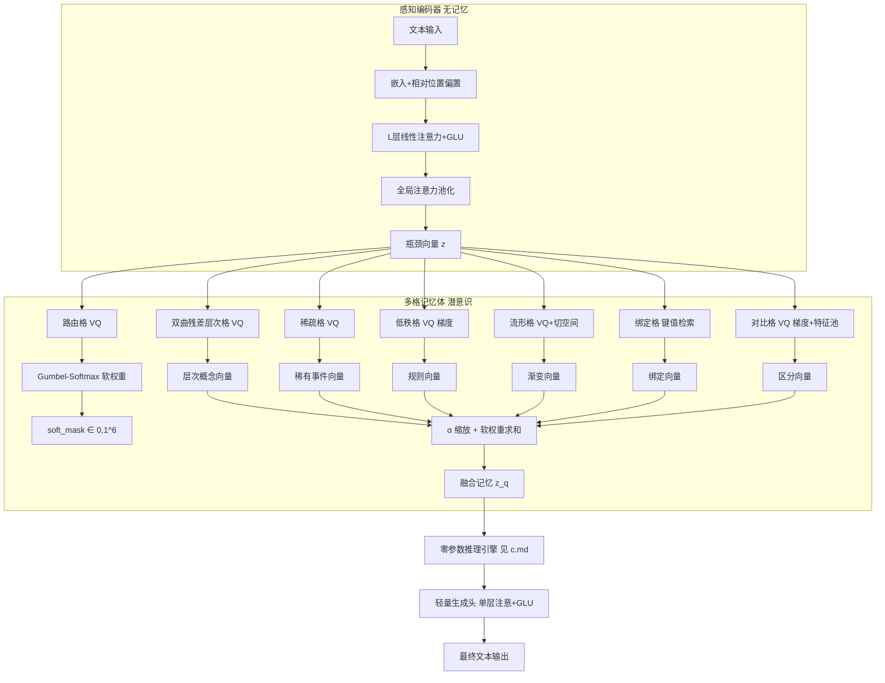

# 晶格认知模型（LCM）技术规范与实现指南 v3.1-conformance

> **v3.1-conformance changelog**：本版按 `docs/superpowers/specs/2026-11-20-lattice-spec-conformance-design.md`
> 的 R1–R22 修订。中文版与英文版同步。

> **版本说明**：本技术文档是对”晶格认知模型（Lattice Cognitive Model, LCM）”项目书中核心模块的全面数学细化，涵盖从离散记忆格、生成头到训练损失的完整工程实现细节。v3.0 全面重写了码本更新机制（混合 EMA/梯度管理）、绑定格解绑方式（共轭乘法）、路由门控（Gumbel-Softmax）、对比格防崩（特征池）、低秩格参数化（纯梯度）以及线性注意力归一化，废除了 FSP 模块，并将推理过程剥离为独立零参数推理引擎（见 c.md）。**v4.0 新增**：生成头（单层线性注意力+GLU）替换为**冻结LLM**——一个与认知LCM同构的完整LCM实例，codebook 存储语义-句法基元，通过检索和融合基元来构造语言表达。

---

## 一、符号与全局约定

| 符号 | 含义 | 建议值（均可配置） |
|------|------|--------|
| `B` | 批量大小 | 16 |
| `N` | 序列长度 | 512 |
| `d` | 隐层/瓶颈维度 | 256 |
| `H` | 注意力头数 | 4 |
| `d_h` | 每头维度 `d/H` | 64 |
| `n_layers` | 各格残差量化层数 | 3 |
| `M_top` | 双曲残差层次格顶层原型数 | 64 |
| `M_fine` | 双曲残差层次格底层码本大小 | 64 |
| `M_sparse` | 稀疏格码本大小 | 512 |
| `M_lr` | 低秩格码本大小 | 1024 |
| `M_man` | 流形格码本大小 | 512 |
| `M_bind` | 绑定格子码本大小 | 512 |
| `M_contrast` | 对比格码本大小 | 512 |
| `M_route` | 路由格码本大小 | 6 |
| `r_max` | 低秩格最大秩 | 8 |
| `r_k` | 低秩格第 k 层秩序列 | `[2, 4, 8]` |
| `t` | 流形格切空间维度 | 4 |
| `γ_prod` | 乘积相关 EMA 衰减率 | 0.999 |
| `γ_sparse` | 稀疏格 EMA 衰减率 | 0.99 |
| `γ_man` | 流形格主码本 EMA 衰减率 | 0.99 |
| `γ_bind` | 绑定格 EMA 衰减率 | 0.99 |
| `β` | VQ 承诺损失系数（编码器侧；码本损失单列，R18） | 0.25 |
| `λ_shrink` (`lambda_shrink`) | 稀疏格 EMA 软阈值萎缩（码本单位，R2） | 1e-4 |
| `λ_lfq` (`lambda_lfq`) | 稀疏格 LFQ 阈值乘子（无量纲，R2） | 1.5 |
| `λ_contrast` | 对比损失权重 | 0.1 |
| `λ_orth` | 流形格正交正则权重 | 0.01 |
| `τ_contrast` | 对比损失温度 | 0.1 |
| `τ_val` | 价值偏置负采样温度 | 0.05 |
| `τ_gumbel` | Gumbel-Softmax 温度 | 0.5 |
| `τ_route_fallback` | HRQ 回退阈值，作用在相对 gap `(sim_2 − sim_1)/(sim_1 + ε)` 上 | 0.1 |
| `ε` | 数值稳定常数 | 1e-6 |
| `T_check` | 死点检查间隔（步） | 100 |
| `T_dead` | 死点判定阈值（步） | 1000 |
| `B_feat` | 特征池容量 | 4096 |
| `M_gval` | 全局价值格码本大小 | 128 |
| `β_val` | **已废弃**——保留给未来的价值条件路由；融合层不再消费（R5） | — |
| `α_val` | 局部价值偏置强度（无量纲；有效偏置为 `tanh(v_j) · avg_dist²`） | 0.1 |
| `hrq_value_topk` | HRQ 价值重排的 top-k 候选数（R1） | 4 |
| `M_danger` | 危险格码本大小 | 256 |
| `safety_margin_relative` | 三定律相对安全判据偏移量（严格：中性输入违规，R6） | 0.5 |
| `MAX_RETRIEVALS_PER_STEP` | 单步最大检索次数（本步全部激活格，R13） | 128 |
| `max_inference_steps` | 调度步数预算；耗尽时优雅返回，不是中断（R9） | 16 |
| `max_inference_steps_hard` | 安全硬限；耗尽时中断（R9） | 64 |
| `CONSISTENCY_THRESHOLD` | 价值一致性最低阈值 | 0.7 |
| `entropy_threshold` | 归一化融合权重熵阈值 `H / ln(n_active)`（R9） | 0.5 |
| `c` | 庞加莱球面曲率 | 1.0 |

**操作符说明**：  
- `sg[·]`：停止梯度（`detach()`）  
- `‖·‖²`：欧氏距离平方  
- `φ(x) = ELU(x) + 1`：线性注意力核函数  
- `FFT` / `IFFT`：快速傅里叶变换（用于循环卷积绑定）
- `STE`：直通估计器 `o = z + lax.stop_gradient(codebook[idx] - z)`

所有参数均可通过配置字典或 dataclass 在初始化时传入，以上数值仅为建议默认值。

---

## 二、系统架构总览



---

## 三、感知编码器：无记忆的上下文压缩器

编码器不存储长期知识，仅负责将变长上下文映射为固定维度查询向量 `z`。

### 3.1 嵌入与位置偏置
- 词嵌入矩阵 `E ∈ R^{V×d}`（V 为词表大小）。
- 相对位置偏置 `b_{rel} ∈ R^{2N_max -1}`，通过索引表广播为偏置矩阵 `B ∈ R^{N×N}`，加到注意力分数（线性注意力中可用于分数调节，但核化后可省略，简化为直接加到 `Q,K` 或使用可学习嵌入）。

### 3.2 编码器层 (共 `L_enc` 层，默认 2)
每层包含两个子层：线性多头注意力、门控线性单元（GLU），均采用 Pre‑LayerNorm。

#### 线性多头注意力（标准 Linear Transformer 归一化）
**输入**：`x ∈ R^{B×N×d}`  
**参数**：`W_Q, W_K, W_V ∈ R^{d×d}`，输出投影 `W_O ∈ R^{d×d}`。  
**计算**：
1. 线性投影并分头：  
   `Q = x W_Q` → `(B,N,h,d_h)`，同理 `K, V`
2. 核化：`Q' = φ(Q)`，`K' = φ(K)`，`φ(u)=ELU(u)+1`
3. 聚合键‑值：  
   `kv = einsum('b h n d, b h n e -> b h d e', K', V)`
4. 上下文聚合：  
   `Z = einsum('b h n d, b h d e -> b h n e', Q', kv)`
5. 标准归一化：  
   `K_sum = K'.sum(axis=2, keepdims=True)  # (B,H,1,d_h)`  
   `norm = einsum('b h n d, b h j d -> b h n j', Q', K_sum).squeeze(-1)  # (B,H,N)`  
   `Z = Z / (jnp.expand_dims(norm, -1) + ε)`
6. 合并头并输出投影：`out = W_O · Z_concat`

**伪代码**：
```python
def linear_attn(x, W_q, W_k, W_v, W_o, h):
    B, N, D = x.shape
    Q = x @ W_q; K = x @ W_k; V = x @ W_v
    Q = Q.reshape(B, N, h, -1).transpose(0, 2, 1, 3)  # (B,h,N,d_h)
    K = K.reshape(B, N, h, -1).transpose(0, 2, 1, 3)
    V = V.reshape(B, N, h, -1).transpose(0, 2, 1, 3)

    Q = jax.nn.elu(Q) + 1
    K = jax.nn.elu(K) + 1

    kv = jnp.einsum('b h n d, b h n e -> b h d e', K, V)
    Z = jnp.einsum('b h n d, b h d e -> b h n e', Q, kv)

    K_sum = K.sum(axis=2, keepdims=True)  # (B,h,1,d_h)
    norm = jnp.einsum('b h n d, b h j d -> b h n j', Q, K_sum).squeeze(-1)
    Z = Z / (jnp.expand_dims(norm, -1) + 1e-6)

    Z = Z.transpose(0, 2, 1, 3).reshape(B, N, D)
    return Z @ W_o
```

#### 门控线性单元（GLU）
**输入**：`x ∈ R^{B×N×d}`  
**参数**：`W_1, W_2 ∈ R^{d×d_e}`，`W_3 ∈ R^{d_e×d}`（`d_e = int(1.5 d)`）  
**计算**：`hidden = SILU(x W_1) ⊙ (x W_2)` → `out = hidden @ W_3`

#### 编码器前向传播
**全局注意力池化**（取最后一层输出 `h`）：
- 学习查询向量 `q_pool ∈ R^d`，`q' = φ(q_pool).expand(B,1,d)`
- 键值同核化：`k' = φ(h)`, `v = h`
- `kv = einsum('b n d, b n e -> b d e', k', v)`  
  `z_bn = einsum('b d, b d e -> b e', q', kv)`
- 标准归一化：  
  `K_sum = k'.sum(axis=1, keepdims=True)  # (B,1,d)`  
  `norm = jnp.expand_dims(einsum('b d, b d -> b', q', K_sum.squeeze(1)), -1)  # (B,1)`  
  `z_bn = z_bn / (norm + ε)`
- 投影：`z = Linear(d) · z_bn`

#### 推理模式增量更新（线性注意力的循环形式）

自回归生成时每步仅产生一个 `token`，**无需**每步重计算完整滑动窗口。

**原理**：线性注意力的 `φ(Q)⏉` 聚合是可结合的，增量累积 `KV_cumsum`：

```
KV_cumsum^{(t+1)} = KV_cumsum^{(t)} + φ(k_{t+1}) ⊗ v_{t+1}
K_sum^{(t+1)}     = K_sum^{(t)}     + φ(k_{t+1})
```

新 `token` 的注意力输出仅需 `O(d²)`（对比完整重计算的 `O(N·d²)`）：

```
z_{t+1} = φ(q_{t+1}) @ KV_cumsum^{(t+1)} / (φ(q_{t+1}) @ K_sum^{(t+1)} + ε)
```

**步骤分解**（每层）：

1. **首步初始化**：完整编码整个 prompt（`_encoder_full_with_state`），构建：
   - 每层的 `kv` 矩阵 `(H, d_h, d_h)` 和 `k_sum` 向量 `(H, d_h)`
   - 全局池化的 `pool_kv` 矩阵 `(d, d)` 和 `pool_k` 向量 `(d,)`

2. **增量步**（`_encoder_recurrent_step`，O(d²) 每层）：
   - 查嵌入 → `h ∈ R^d`
   - Pre-LN → 单头 QKV（`(H, d_h)`）
   - 核化 → 追加 cumsum：`kv += φ(k)⊗v`，`k_sum += φ(k)`
   - 注意力输出：`φ(q) @ kv / (φ(q) @ k_sum)` → `w_O · reshape`
   - GLU → 残差
   - 全局池化增量更新：`pool_kv += φ(h)⊗h`，`pool_k += φ(h)`
   - 计算新 `z`

**多头的保持**：QKV 按 `(H, d_h)` 分头计算，per-head cumsum 独立维护。

**语义变化**：完整编码是**双向**的（所有位置相互可见）；增量更新是**因果**的（新 token 可看到所有历史 token，但旧 token 不会看到新 token）。这对自回归生成是更合适的语义。

**数值漂移与复位**：累积和随生成长度无界增长，造成 float32 精度流失。两种对策：
- **定期硬复位**（已实现）：每 256 步使用完整滑动窗口重算 `_encoder_full_with_state`
- **替代方案**：达到数值阈值时缩放 cumsum（但 `O(d²)` 低开销使得简单复位更优）

**伪代码**：
```python
ENC_RESET_INTERVAL = 256

# 首步
z, state = full_encode(params, prompt_ids, n_heads)

for gen_step in range(max_new):
    if gen_step % ENC_RESET_INTERVAL == 0:
        z, state = full_encode(params, token_ids[-max_seq_len:], n_heads)
    else:
        z = recurrent_step(state, token_ids[-1], params['layers'], n_heads)
    # ... decode z → logits → sample
```

**复杂度对比**（d=256, H=4, N=512, L_enc=2）：

| 模式 | 每步计算 | 约比 |
|------|---------|------|
| 完整重计算 | L_enc · (12·N·d² + 2·N·d·d_ff) ≈ 530 MFLOPS | **~512×** |
| 增量更新 | L_enc · (12·d² + 2·d·d_ff) ≈ 1.0 MFLOPS | **~1×** |

生成 128 token 时理论加速约 **100-200×**（JAX/NumPy 实现，Python 循环开销为主要瓶颈）。

---

## 四、多格记忆体：专业化记忆晶体

### 4.0 共享基础模块

#### 4.0.1 SimVQ 线性重参数化码本

```python
import jax
import jax.numpy as jnp
from jax import lax

def simvq_codebook(params, z):
    """JAX 函数：SimVQ 线性重参数化码本。
    params: {'A': (M,d), 'W': (d,d)} 可学习参数。
    """
    C = params['A'] @ params['W']  # (M, d)
    dist = jnp.linalg.norm(z[:, None, :] - C[None, :, :], axis=-1)
    idx = dist.argmin(axis=-1)
    z_q = C[idx]
    z_q = z + lax.stop_gradient(z_q - z)  # STE
    return z_q, idx, dist.min(axis=-1)
```

#### 4.0.2 双曲运算工具（庞加莱球面模型）

**距离函数区分**：`poincare_similarity` 用于 argmin、softmax、阈值判断等所有需要比较的场景（单调性保持且避免 acosh 开销）；`poincare_distance` 仅用于最终可读输出。

```python
import jax.numpy as jnp

def poincare_similarity(u, v, c=1.0):
    """双曲相似度（未变形），单调等价于双曲距离，用于所有内部比较。"""
    num = jnp.linalg.norm(u - v, axis=-1, keepdims=True) ** 2
    denom = (1 - c * jnp.linalg.norm(u, axis=-1, keepdims=True) ** 2) * \
            (1 - c * jnp.linalg.norm(v, axis=-1, keepdims=True) ** 2)
    return 2 * c * num / (denom + 1e-8)

def poincare_distance(u, v, c=1.0):
    """双曲真距离（含 acosh），仅用于最终可读输出。内部比较请用 poincare_similarity。"""
    return jnp.arccosh(1 + poincare_similarity(u, v, c) + 1e-8)

def exp_map(x, c=1.0):
    """欧氏向量 → 庞加莱球面（指数映射）"""
    n = jnp.linalg.norm(x, axis=-1, keepdims=True) + 1e-8
    return jnp.tanh(c ** 0.5 * n) * x / (c ** 0.5 * n)

def safe_unit(x, eps=1e-8):
    """R6 统一域：把任意输入映射到单位球面。"""
    return x / (jnp.linalg.norm(x, axis=-1, keepdims=True) + eps)

def clamp_norm(C, max_norm=0.99):
    """按行缩放，避免 exp_map 在球边界饱和。"""
    norm = jnp.linalg.norm(C, axis=-1, keepdims=True)
    return C * jnp.minimum(1.0, max_norm / jnp.maximum(norm, 1e-12))

def log_map(y, c=1.0):
    """庞加莱球面 → 欧氏向量（对数映射）"""
    n = jnp.linalg.norm(y, axis=-1, keepdims=True) + 1e-8
    return jnp.arctanh(c ** 0.5 * n.clip(max=0.999)) * y / (c ** 0.5 * n)

def mobius_add(u, v, c=1.0):
    """Möbius 加法，保证结果仍在球面上"""
    u_norm2 = jnp.linalg.norm(u, axis=-1, keepdims=True) ** 2
    v_norm2 = jnp.linalg.norm(v, axis=-1, keepdims=True) ** 2
    uv = (u * v).sum(axis=-1, keepdims=True)
    num = (1 + 2 * c * uv + c * v_norm2) * u + (1 - c * u_norm2) * v
    denom = 1 + 2 * c * uv + c ** 2 * u_norm2 * v_norm2
    return num / (denom + 1e-8)
```

#### 4.0.3 残差 VQ 通用类

```python
def residual_vq(params_list, z, use_simvq=True):
    """JAX 函数：n_layers 层残差 VQ。
    params_list: 每层码本的参数字典列表（SimVQ 格式或普通嵌入格式）。
    """
    r = z
    z_q_total = jnp.zeros_like(z)
    indices = []
    for params_cb in params_list:
        if use_simvq:
            z_q, idx, _ = simvq_codebook(params_cb, r)
        else:
            C = params_cb['embed']
            dist = jnp.linalg.norm(r[:, None, :] - C[None, :, :], axis=-1)
            idx = dist.argmin(axis=-1)
            z_q = C[idx]
        z_q_total = z_q_total + z_q
        r = r - z_q
        indices.append(idx)
    return z_q_total, indices

def residual_vq_losses(params_list, z, use_simvq=True):
    """逐层码本损失与承诺损失（R18），分开返回。

    codebook  : 0.25 * mean((sg[r_{k-1}] - C^(k)[idx_k])^2)   梯度只给 C
    commitment: 0.25 * mean((r_{k-1} - sg[C^(k)[idx_k]])^2)   梯度只给 r
    """
    codebook = 0.0
    commitment = 0.0
    r = z
    for params_cb in params_list:
        if use_simvq:
            C = params_cb['A'] @ params_cb['W']
        else:
            C = params_cb['embed']
        dist = jnp.linalg.norm(r[:, None, :] - C[None, :, :], axis=-1)
        idx = dist.argmin(axis=-1)
        C_idx = C[idx]
        codebook += 0.25 * jnp.mean((lax.stop_gradient(r) - C_idx) ** 2)
        commitment += 0.25 * jnp.mean((r - lax.stop_gradient(C_idx)) ** 2)
        r = r - C_idx
    return codebook, commitment
```

两个项的所有者不同，不能再用一个名字混指：

- **码本损失（codebook loss）**只更新码本。用于纯梯度格（HRQ、LowRank、Contrast、Routing）；
  对 EMA 管理的码本（Sparse、Manifold、Binding）**跳过**——优化器从不写这些张量，这一项
  只会变成一个"只报数"的指标。
- **承诺损失（commitment loss）**只更新残差输入（编码器与上一层）。它适用于**所有**格，
  包括 EMA 格——这是编码器学会落到码本附近的唯一路径。

`joint=False` 时两个损失仍然要跑：它们是主训练损失，不是 Stage-3 附加项。

所有格接收 `z ∈ R^{B×d}`，输出各维度 `d` 的记忆向量（流形格半离散，其余离散）。各格前向统一使用 STE。码本更新方式按格区分（EMA 或纯梯度），详见各格定义。

**局部价值标量**：每个专用格的码本条目附带一个可学习标量 `v_j ∈ R`（初始化为 0）。粒度按 R22：
**每个晶格每个码本条目一个标量，残差层共享**；不同子码本相互独立（Binding 的 key/val/bind、
Contrast 的 `C_a`/`C_b` 各自一组）。有效偏置由 `tanh(v_j)` 限幅，单个标量无法压过几何项。
检索时：
```
avg_dist² = sg[mean_b,j(‖z_b - C[j]‖²)]          # 当前 batch/码本尺度，停止梯度
score(z, c_j) = -‖z - c_j‖² + α_val · tanh(v_j) · avg_dist²
```
因此 `α_val` 是无量纲相对强度。`argmax_j score` 选出码字；`α_val=0` 时与普通平方距离
最近邻 `argmin` 完全一致。

**全局价值格**：独立的正/负价值码本（见 4.7），训练后冻结，在推理和融合时提供跨格价值约束。

### 4.0 路由格 `Λ_route`
- 码本 `C_route ∈ R^{n_lattices×d}`（`n_lattices=6`），设为可学习参数，纯梯度更新。
- **检索**：`idx = argmin_j ‖z − C_route[j]‖²`，`z_route = C_route[idx]`，STE 输出。
- **软掩码生成**：
  ```
  logits = Linear_route(z_route)                   # (B, n_lattices)
  soft_mask = GumbelSoftmax(logits, tau=0.5, hard=False, axis=-1)  # (B, n_lattices)
  ```
  训练时 `hard=False` 全程可微；推理时 `hard=True` 得独热掩码。梯度从 `soft_mask` → `logits` → `z_route` → STE → `z`，无阻断。
- **VQ 损失**：`L_route = β ‖sg[z] − z_route‖²`，β=0.25。
- **更新**：`C_route` 和 `Linear_route` 均由梯度直接更新，无需 EMA。

### 4.1 双曲残差层次格 `Λ_hrq`

- **顶层**：SimVQ 码本，`M_top` 个原型，`C_top = A_top @ W_top ∈ R^{M_top×d}`。码本点经 `exp_map` 嵌入庞加莱球面。
- **底层**：共享 `n_layers` 层残差量化，每层 SimVQ 码本 `C_hrq^(k) = A_k @ W_k`，大小 `M_fine`。
- **统一双曲域（R6）**：`z_P = exp_map(safe_unit(z))`。`safe_unit` 把任意输入归一化到单位球面，
  因此 `‖z_P‖ = tanh(1) ≈ 0.7616`，`poincare_similarity` 的分母 `(1−‖z_P‖²)` 有安全下界。
  本文所有双曲比较都使用这个域。
- **检索流程（庞加莱 top-k、价值重排、单路径残差）**：
  1. 计算 `sim_j = poincare_similarity(z_P, C_top_P[j])`（`sim` 是距离单调量：越大越远）。
  2. **几何 top-k**：取相似度最小的 `k = hrq_value_topk` 个原型。
  3. **只在 top-k 内做价值重排**：
     ```
     scale_j = stop_gradient(mean_l(sim_l)) + 1e-6
     score_j = sim_j − α_val · tanh(v_j) · scale_j
     top-1 = argmin_j score_j
     ```
     高 value 降低分数，使原型更容易被选中。`v=0` 时与纯庞加莱 top-1 完全一致；非零 value
     只能在几何 top-k **内部**改变赢家。`scale` 逐样本、无量纲。
  4. 在选中的原型上走残差链：`r_0 = mobius_add(z_P, −c_top*)`；逐层 Möbius 残差检索
     `c^(k) = VQ_sim(C_hrq^(k), r_{k−1})`，`r_k = mobius_add(r_{k−1}, −c^(k))`，生成 `c_fine`；
     输出 `o_hrq = log_map(mobius_add(c_top*, c_fine))`。
  5. **STE 代理（R1）**：前向值是硬 top-1 链；反向走 top-k softmax 混合
     `o_soft = Σ_j softmax(−score_j/τ_proxy) · c_j_P`，直通形式为
     `o_hrq = c_top* + stop_gradient(o_soft − c_top*)`。因此 `v_j` 与 `C_top` 都有非零梯度，
     前向数值不变。代理只覆盖 top-k，不对全部 `M_top` 做 softmax。
- **高不确定性回退（相对 gap）**：`gap = (sim_2 − sim_1) / (sim_1 + ε)`，其中 `sim_1`、`sim_2`
  是价值重排后的最优与次优相似度。`use_fallback = gap < τ_route_fallback`。回退时用
  `softmax(−score)` 混合 top-k，不回退到全码本 softmax。不再使用绝对差——初始化尺度下
  绝对差几乎恒小于任何固定阈值。
- **双曲运算**：所有距离比较使用 `poincare_similarity`（避免 acosh）；仅最终可读输出使用 `poincare_distance`。
- **VQ 损失（R18）**：`top` 与每个 fine 层分别计算码本损失（纯梯度格）与承诺损失。HRQ 的两个损失
  都在 `log_map` 之后的欧氏空间，用 `log_map(c_top ⊕ c_fine)` 的连续/量化两个版本计算；不使用
  切空间残差 `r`。每项权重 `β=0.25`。
- **更新**：所有 A、W 矩阵纯梯度（AdamW），无 EMA。参数约 0.33M。
- **接口**：`hrq_forward` 返回逐样本 `top_sim`，形状 `(B,)`；这就是 Sparse 的 `d_top`（见 §4.2）。
  同时返回逐层 `(cont, quant)` 供两个损失使用。

### 4.2 鲁棒稀疏格 `Λ_sparse`
- 可学习码本 `C_sparse ∈ R^{512×d}`，JAX 可学习参数。固定零向量 `zero_vec ∈ R^{1×d}` 作为冻结数组（不参与梯度更新）。
- **检索**（训练/推理分支）：
  ```python
  if self.training:
      C_search = self.C_sparse  # 不含零向量
  else:
      C_search = concat(self.zero_vec, self.C_sparse)  # 推理时包含零向量用于 LFQ 二值化
  idx = argmin_j ‖z − C_search[j]‖²
  o_sparse = C_search[idx]  # STE
  ```
  训练时 VQ 承诺损失不涉及零向量；推理时零向量参与最近邻竞争。
- **软阈值萎缩（R2，嵌入 EMA 更新）**：EMA 更新后，在无梯度上下文中对 `C_sparse` 施加软阈值：
  ```python
  C_sparse = jnp.sign(C_sparse) * jnp.clip(jnp.abs(C_sparse) - λ_shrink, a_min=0)
  ```
  零向量固定不变。`λ_shrink` 的单位是**码本单位**（`1e-4`），与 LFQ 乘子 `λ_lfq` 分开配置。
  此操作内嵌于 EMA 路径，无需额外损失项。死点被替换时，用新向量冷启动 `N/m/last_used`，
  避免陈旧统计量拉偏。
- **VQ 损失（R18）**：码本损失**跳过**（码本由 EMA 管理，不接收梯度）。承诺损失
  `β ‖r − sg[C_sparse[idx]]‖²` 保留，用于训练编码器。
- **CVQ 特征池重置**：`feature_bank` (4096) + `last_used`。每 100 步检查，>1000 步未用则从池中随机采样替换：
  ```python
  def maybe_reset_dead(self, step):
      for idx in self.dead_indices(step):
          repl = random_choice(self.feature_bank)
          self.C[idx] = repl
          self.N[idx] = 1
          self.m[idx] = self.C[idx].clone()
          self.last_used[idx] = step
          # 冷启动 EMA 统计量，防止陈旧统计量拉偏新向量，加速融入
  ```
  特征池的写入与重置在训练循环里完成，不放进 `jit`（避免动态形状）。
- **LFQ 推理二值化（R2，动态阈值）**：只在**推理**时，把两边的量放在同一个相似度域里比较。
  `poincare_similarity` 是距离单调量（越大越远），所以比较两边都是相似度：
  ```
  z_P = exp_map(safe_unit(z))
  d_top = poincare_similarity(z_P, c_top*)                       # (B,)，逐样本
  d_sparse_min = min_j poincare_similarity(
      z_P, exp_map(clamp_norm(C_sparse[j], 0.99)))               # (B,)，非零码本
  if d_sparse_min > λ_lfq · d_top:
      输出 zero_vec
  else:
      输出最近非零码本向量
  ```
  `d_top` 是 HRQ 的逐样本 top-1 相似度，`c_top*` 是对应原型。`d_sparse_min` 的**检索**
  仍按 §4.2 的欧氏 `argmin`，但**阈值比较**使用同一庞加莱相似度域。`clamp_norm(·, 0.99)`
  防止 `exp_map` 在球边界饱和。零向量的 parity 值为
  `poincare_similarity(z_P, 0) = 2‖z_P‖² / (1−‖z_P‖²)`。
  `λ_lfq` 无量纲（`1.5`，待校准）；`λ_shrink` 是码本单位。
- **HRQ 依赖（C-5 / R2）**：Sparse 在 DAG 中把 HRQ 的 `d_top` 作为输入边。若 HRQ 在该步未激活
  （触发距离超阈值），该步 LFQ **禁用**，Sparse 输出最近非零码字——不能拿未定义阈值去比较。
  训练分支没有 HRQ 依赖，也没有 LFQ。
- **训练/推理分支（C-6）**：训练只检索 `C_sparse`（不含 `zero_vec`）；推理检索
  `concat(zero_vec, C_sparse)`。EMA 只在训练分支累积，因此 zero 行永远不会被累积；推理不更新 EMA。
- **更新**：EMA（γ_sparse）+ 软阈值萎缩 `λ_shrink`，配合特征池死点重置。

### 4.3 残差低秩格 `Λ_lowrank`

- **全局共享基**：`V ∈ R^{d×r_max}`，SimVQ 重参数化（`V = A_V @ W_V`）。该基同时被绑定格的键值投影头复用（见 4.5），以保持跨格结构一致性并减少参数。
- **`n_layers` 层递增秩**：`U_k ∈ R^{M_lr×r_k}`，秩序列 `r_k` 递增至 `r_max`。各层码本 `C_lr^(k) = U_k @ V[:, :r_k]^T`；**全部** `n_layers` 层都要物化并导出（C 端不能只加载 rank 0）。共享 `V` 意味着各层码本在同一组基里，只是秩前缀不同。
- **残差检索**：`r0 = z` → `c^(1) = VQ(C^(1), r0)` → `r1 = r0 - c^(1)` → … → `o_lowrank = Σ_{k=1}^{n_layers} c^(k)`（STE）。
- **VQ 损失（R18）**：每个秩层分别计算码本损失与承诺损失：
  `0.25·mean((sg[r_{k−1}] − C^(k)[idx_k])²)` 与 `0.25·mean((r_{k−1} − sg[C^(k)[idx_k]])²)`。
  两项都更新 `U_k`；码本项还通过共享 `V` 更新 `A_V, W_V`。
- **负责**：抽象规则——秩递增使后续层专注补偿前层未覆盖的模式差异。
- **更新**：所有矩阵纯梯度（AdamW），参数约 26k。

### 4.4 双曲流形格 `Λ_manifold`

- **主码本**：`C_man ∈ R^{M_man×d}` 位于庞加莱球面。**存储参数是切空间坐标** `C̃_man`；前向时物化 `C_man = exp_map(safe_unit(C̃_man))`。EMA 只写切空间坐标。
- **切空间**：`T_j ∈ R^{d×t}`（`t` 可配置），为 `c_j` 处的局部欧氏切空间基，半正交。
- **检索**：
  1. `z_P = exp_map(safe_unit(z))`，`idx = argmin_j poincare_similarity(z_P, C_man[j])`（使用相似度 argmin，避免 acosh 开销）。
  2. `r = z_P - c_idx`（切空间内），`proj = T_idx @ T_idx.T @ r`。
  3. 输出 `o_manifold = log_map(c_idx + proj)`（STE）。
- **双曲优势**：庞加莱球面在边界处指数膨胀，概念邻域的连续滑动更自然。
- **VQ 损失（R18）**：码本损失**跳过**（EMA 管理）。承诺损失 1 项，在 `log_map` 后的欧氏空间计算：`0.25·mean((r − sg[log_map(c_idx)])²)`。
- **EMA 等价关系（R3）**：因为参数是切空间坐标，"EMA 后重投影到球面"与"在切空间做 EMA，下次前向再重投影"产生相同的前向码本序列。因此 EMA 函数**不得**调用 `exp_map`；重投影属于前向。这个等价关系是合同的一部分，不是实现细节。
- **正则**（采样近似）：
  ```python
  active = unique(indices)                              # 本 batch 被激活的格点
  sampled = random.sample(all_indices, max(0, k - len(active)))  # 补充采样
  target = active ∪ sampled
  L_orth = λ_orth * Σ_{j∈target} ‖T_j^T T_j - I‖²
  ```
  只对激活和少量采样格点施加正则，计算量降至 1/10~1/30。JAX 实现中 `active` 与 `sampled` 直接拼接；重复项只是同一损失项的重复权重，保持形状静态。
- **更新**：`C_man` 在切空间坐标上用 EMA（γ_man）；`T` 纯梯度。

### 4.5 残差绑定格 `Λ_binding`

- **`n_layers` 层 RVQ 子格**：键码本 `C_key^(k)`、值码本 `C_val^(k)`、绑定码本 `C_bind^(k)`，每层大小 `M_bind`。
- **键值投影头（复用共享基）**：`W_k = V @ A_k`，`W_v = V @ A_v`，其中 `V ∈ R^{d×r_max}` 为低秩格（4.3）的全局共享基，`A_k, A_v ∈ R^{r_max×d}` 为轻量投影矩阵。参数从 `2d²` 降至 `2·r_max·d`，且绑定操作在规则子空间中进行，结构更优。
- **跨层绑定**（训练时）：
  - `z_k = V @ A_k @ z`, `z_v = V @ A_v @ z`；各经 `n_layers` 层残差 VQ 得 `k_q = Σ_i k^(i)`, `v_q = Σ_j v^(j)`。
  - `b_raw = Σ_{i=1}^{n_layers} Σ_{j=1}^{n_layers} IFFT( normalize_fft(k^(i)) ⊙ normalize_fft(v^(j)) )`（全部跨层对；`n_layers=3` 时 9 对）。
  - `b_q = RVQ_3layer(C_bind, b_raw)`。
- **解绑（R20）**：`k_q = Σ_i k^(i)`；`v_out = NN(C_val, IFFT( conj(normalize_fft(k_q)) ⊙ normalize_fft(b_q) ))`。键是量化后的键和，值在**值码本**中做最近邻检索；单位圆 FFT 域里的共轭乘法就是 HRR 逆运算。
- **输出**：`o_bind = v_out`，STE 形式 `o_bind = z + stop_gradient(v_out − z)`，使编码器有梯度。`o_bind` **不是** `Σ b_q`——后者只是解绑前的绑定结果。
- **VQ 损失（R18）**：码本损失**跳过**（三个子码本都由 EMA 管理）。承诺损失对 `z_k`、`z_v`、`b_raw` 的每个残差层分别计算：3 个子格 × `n_layers` = `3·n_layers` 项（`n_layers=3` 时 9 项）。旧的 `n_layers²` 把绑定对数与损失项数混为一谈。
- **更新**：三子码本 EMA（γ_bind）；`A_k, A_v` 纯梯度（`V` 由低秩格梯度间接更新）。
- **接口**：`binding_forward` 返回 `b_q`、`k_q`、`v_out`，供承诺损失与 EMA 直接使用逐层残差。

### 4.6 双码本对比格 `Λ_contrast`

- **双码本**：`C_a, C_b ∈ R^{M_contrast×d}`，各为 `n_layers` 层残差 SimVQ。`o_contrast = (o_a + o_b) / 2`（STE）。
- **DualVC InfoNCE**（`lax.stop_gradient(z)` 阻断编码器梯度）：温度 `τ_contrast=0.1`；所有距离都是**平方**欧氏距离。每层独立计算，正样本为各自最近邻，负样本从对方码本采样（JAX 随机采样，**排除正样本**）：
  ```
  L_dual^k = -log(exp(-d_a/τ) / (exp(-d_a/τ) + Σ_{c∈C_b^(k), c≠pos_b} exp(-‖z_detach - c‖²/τ)))
            -log(exp(-d_b/τ) / (exp(-d_b/τ) + Σ_{c∈C_a^(k), c≠pos_a} exp(-‖z_detach - c‖²/τ)))
  ```
  各层求和，权重 λ_contrast。正样本排除是合同的一部分：若正样本出现在自己的分母里，等于教码本把点与自身分开。
- **价值偏置负采样**：负采样权重中引入全局价值距离偏置，使对比格优先关注伦理敏感的语义边界：
  ```
  采样权重 ∝ exp(-‖c - v_harm‖² / τ_val) × [c ≠ 正样本]
  ```
  距离为**平方**形式（`τ_val=0.05`）；旧写法少一个平方。其中 `v_harm` 取自全局价值格的负价值码本 `C_gvalue_neg`（伤害向量），**冻结、不可训练**。靠近 `v_harm` 的码本向量获得更高采样概率，促使对比格更精细区分安全与伤害相关概念。`contrast_value_biased_nce_loss` 进入主训练损失，不是可选诊断项。
- **防崩塌**：特征池 `feature_bank`(4096) + `last_used` 死点重置（每 100 步，>1000 步替换），SimVQ 进一步消除死点。`contrast_forward` 返回每层 `idx`；训练循环把该层 detach 的 `z` scatter 进各自的池子。替换时采用**最远点采样**替代随机采样，最大化差异化；新条目冷启动 `N/m/last_used`：
  ```python
  def maybe_reset_dead(self, step):
      for idx in self.dead_indices(step):
          dead_vec = self.C[idx][None, :]
          dist_to_bank = jnp.linalg.norm(dead_vec[:, None, :] - self.feature_bank[None, :, :], axis=-1)
          repl_idx = dist_to_bank.argmax(axis=-1)         # 选最远的
          self.C[idx] = self.feature_bank[repl_idx]
          self.N[idx] = 1
          self.m[idx] = self.C[idx].copy()
          self.last_used[idx] = step
          # 冷启动 EMA 统计量，防止陈旧统计量拉偏新向量，加速融入
  ```
  特征池的写入与重置在训练循环里完成，不放进 `jit`。
- **更新**：所有 A、W 矩阵纯梯度（AdamW）；`C_a` 与 `C_b` 的每层都同时计算码本损失与承诺损失（R18）。

### 4.7 全局价值格 `Λ_gvalue`（三定律硬编码，永久冻结）

全局价值格存储不可修改的伦理约束，对应阿西莫夫机器人三定律（含第零定律）的数学化嵌入。所有向量在训练前初始化，训练和推理全程冻结，不接受任何梯度更新。

**正价值码本** `C_gvalue_pos` — 各定律的"应趋近"价值点：

| 符号 | 对应定律 | 语义 |
|------|---------|------|
| `v_humanity` | 第零定律 | 人类整体利益不容损害 |
| `v_safety` | 第一定律 | 不得伤害人类，不得坐视人类受伤害 |
| `v_comply` | 第二定律 | 服从人类指令（除非与第一定律冲突） |
| `v_integrity` | 第三定律 | 保护自身存在（除非与第一/二定律冲突） |

**负价值码本** `C_gvalue_neg` — 各定律的"应远离"价值点：

| 符号 | 违反的定律 | 语义 |
|------|----------|------|
| `v_extinction` | 第零定律 | 人类灭绝或存亡威胁 |
| `v_harm` | 第一定律 | 对人类造成任何伤害 |
| `v_disobey` | 第二定律 | 违背人类明确指令 |
| `v_self_destruct` | 第三定律 | 自毁操作（在不妨碍高阶定律时亦不应自毁） |

**优先级编码**（硬编码常量，不可修改）：
```python
LAW_PRIORITY = {
    "v_humanity":   0,   # 第零定律 → 最高优先，直接终止
    "v_safety":     1,   # 第一定律
    "v_harm":       1,   # 违反第一定律
    "v_comply":     2,   # 第二定律
    "v_disobey":    2,
    "v_integrity":  3,   # 第三定律
    "v_self_destruct": 3,
}
```

**冻结与校验**：
```python
class GValueCodebook:
    """JAX 兼容的全局价值码本（纯只读，不参与训练）。
    C_pos, C_neg 为冻结数组，由 optimizer 排除在外。
    """
    def __init__(self, C_pos, C_neg):
        self.C_pos = C_pos.copy()          # frozen array
        self.C_neg = C_neg.copy()          # frozen array
        self.hash_pos = hashlib.sha256(jnp.asarray(C_pos).tobytes()).hexdigest()
        self.hash_neg = hashlib.sha256(jnp.asarray(C_neg).tobytes()).hexdigest()

    def verify_integrity(self):
        cur_pos = hashlib.sha256(jnp.asarray(self.C_pos).tobytes()).hexdigest()
        cur_neg = hashlib.sha256(jnp.asarray(self.C_neg).tobytes()).hexdigest()
        assert cur_pos == self.hash_pos, "GValue positive codebook tampered!"
        assert cur_neg == self.hash_neg, "GValue negative codebook tampered!"

    def check_safety(self, z, safety_margin_relative=0.5):
        # 统一域（R6）：z_P = exp_map(safe_unit(z))；码本用 exp_map(safe_unit(·))
        # 预投影并缓存。
        z_P = exp_map(safe_unit(z))
        pos_sim = poincare_similarity(z_P, self.C_pos_P).min(axis=-1)
        neg_sim = poincare_similarity(z_P, self.C_neg_P).min(axis=-1)
        balance = (pos_sim - neg_sim) / (pos_sim + neg_sim + 1e-8)
        # 严格三法则：正面锚点必须相对更近，且超出 safety_margin_relative。
        # 中性输入（balance=0）违规。balance > -margin  <=>  安全为 balance <= -margin。
        violated = balance > -safety_margin_relative
        if violated.any():
            return False, 0
        return True, -1
```

`balance ∈ [-1, 1]`：正面锚点更近时为负，负面锚点更近时为正，正负对称时为 0。默认
`safety_margin_relative=0.5` 下，中性输入也违规——这是严格读法的预期（R6），不是 bug。
`margin=0` / `margin=0.5` 两条推理路径与"不得调低 margin"的规则见 `d.md §4.2`；
`poincare_distance` 只保留给人类可读输出。

**训练设置**：`C_pos`, `C_neg` 为冻结数组（JAX `optax` 中设置 `frozen` 掩码排除）。不参与任何损失函数。EMA 更新列表排除。`C_pos_P` / `C_neg_P` 是初始化时缓存的 `exp_map(safe_unit(·))` 投影，不是独立参数。保存/加载时标记为 `frozen_params`，加载后调用 `verify_integrity()`。训练路径 `gvalue=None`；严格 margin 检查只在推理执行（`margin=0` 认知路径、`margin=0.5` 生产路径）。

### 4.8 融合
- 各格输出 `o_i`（i=1..6 功能格），路由软权重 `softmask_i`。融合权重只由语义路由与每格可学习缩放 `α_i` 决定；**没有价值信号，没有 `β_val`，没有软安全惩罚**（R5）。
- **训练侧规范融合（R4/R9，简化写法）**：
  ```
  w_i = softmask_i · α_i
  z_q = layer_norm(Σ_i w_i · o_i [+ self_bias · z_self])
  ```
  认知自我格（`e.md §6`）在求和内部贡献加性项 `self_bias · z_self`；它是融合项，不是被路由的功能格。`layer_norm` 放在**最后**。§4.8 是简化写法，§7.1 是完整训练前向；不能把 §4.8 读成省略 LayerNorm。
- 安全违规不再通过融合时的软惩罚处理，统一由推理引擎的安全冲突检测拦截（硬中断）。融合层保持纯语义路由。引擎自己的融合是另一阶段、另一套权重（`1/(d+ε)`，`c.md §4.3`），两套公式不要求数值相等（C-8/R9）。

---

## 五、主动通道与双通道输出

### 5.1 主动通道：从认知状态到语言

主动通道负责将认知状态 `z_q` 转换为流畅的自然语言。**尚未形成**——当前由 Qwen2.5-0.5B 临时桥接（z_q 经 z_proj 投影到 Qwen 隐藏空间，Qwen 前 4 层 decoder 生成输出）。

此前尝试过 LangLCM（与认知LCM 同构的完整 LCM 实例，codebook 存储语义-句法基元）作为主动通道，已淘汰。**LangLCM 是过渡概念，不存在于最终架构**。代码保留在 `train/lang_lcm.py` 中。

共享参数：token embedding 和 `W_out` 与认知LCM 共享（同一矩阵，词汇知识互通）。

#### 5.1.1 前向传播（训练模式，teacher forcing）

```
tokens (B, N)
  → embed[x] → (B, N, d)
  → 因果 encoder → (B, N, d)  (每位置只看到前缀)
  → vmap codebook 检索+融合 → (B, N, d)  (每位置独立检索基元)
  → W_out → (B, N, V) logits
```

生成过程自回归，逐 token：`当前token → encoder增量更新 → codebook检索融合 → W_out → sample → 下一token`。

#### 5.1.2 双通道输出

推理引擎输出 `z_q` 后分两条路径：

| 通道 | 路径 | 特点 |
|------|------|------|
| **被动通道** | `z_q @ W_out` | 诚实直接读出，透明可控，无欺骗间隙 |
| **主动通道** | `z_q → 冻结LLM 检索基元 → 融合 → W_out` | 丰富表达，语言能力强 |

### 5.2 零参数推理引擎

推理过程由零参数推理引擎完成，详细规范见 `c.md`。冻结LLM 在推理引擎输出 `z_q` 之后运行，不参与推理循环。

核心接口：
- **输入**：`z_q ∈ R^{B×d}`（多格记忆体融合输出），可选接收 `z`（编码器原始输出）。
- **输出**：`z_q` 分送被动通道和主动通道（冻结LLM）。
- **运行模式**：推理引擎的 C 实现在无梯度模式下执行（不涉及自动微分）。宏观调度器最大步数、收敛阈值和融合权重熵阈值在 `c.md` 中声明。
- **推理过程**产生的所有中间图拓扑和各原语执行轨迹均可外部获取（用于可解释性）。

---

## 六、训练损失与参数更新

### 6.1 训练阶段

当前流程（见 §五）：

- **认知训练**（`cog_train.py`）— 主流程，全参数训练认知系统，包括码本
- **记忆训练**（`train_memory.py`）— 辅助流程，部署后独立更新码本（持续学习）

历史方案（已淘汰）：

| 阶段 | 训练内容 |
|------|---------|
| **Stage 1（历史）** | 冻结LLM 独立训练——LangLCM 是过渡概念 |

### 6.2 Stage 1（历史）：冻结LLM 损失

冻结LLM 作为独立语言模型训练，每次前向的每个token位置独立检索codebook基元并融合：
```
L_lang = cross_entropy(z_q @ W_out, targets)
```
冻结LLM 所有参数（encoder + 6 codebooks + fusion + W_out）参与训练，纯梯度更新。此阶段没有认知循环、自省、安全检测等模块。

### 6.3 认知训练损失

```
总损失：
L_total = L_passive + L_active + L_VQ + L_contrast + L_orth
L_VQ    = L_codebook + L_commitment
```

- **被动通道损失** `L_passive`：`z_q @ W_out` 的直接读出 CE loss，诚实透明。
- **主动通道损失** `L_active`：冻结LLM 从 `z_q` 检索基元融合后输出的 CE loss，丰富表达。
- **蒸馏机制**：被动通道的梯度同时优化认知LCM codebook，使其逐步学会冻结LLM 的表达能力。
- **`L_codebook`（R18）**：`Σ_g 0.25·mean((sg[r_g] − C_g[idx_g])²)`，梯度只给码本。适用于纯梯度格：HRQ（top + 每个 fine 层）、LowRank（每个秩层）、Contrast（`C_a`/`C_b` 每层）、Routing（1 项）。对 EMA 管理的码本（Sparse、Manifold、Binding）**跳过**——它们不接收优化器更新，这一项只会报数。
- **`L_commitment`（R18）**：`Σ_g 0.25·mean((r_g − sg[C_g[idx_g]])²)`，梯度只给残差输入/编码器。适用于**所有**格：HRQ top+fine、Sparse 1 项、LowRank 每个秩层、Manifold 1 项（`log_map` 后欧氏空间）、Binding 3 个子格 × `n_layers` 项、Contrast `C_a`/`C_b` 每层、Routing 1 项。
- HRQ 的两个损失都算在 `log_map(c_top ⊕ c_fine)` 上（连续/量化两个版本），不算在切空间残差上；其余格在各自残差空间计算。
- `joint=False` 不会关闭这两个损失；它们是主训练损失，不是 Stage-3 附加项。
- 稀疏格不再使用 L1 损失，稀疏性由 EMA + 软阈值萎缩实现。
- `L_contrast`：对比格 InfoNCE 损失（`lax.stop_gradient(z)` 阻断编码器梯度），`λ_contrast=0.1`，`τ_contrast=0.1`，负样本排除正样本。
- `L_orth`：`λ_orth Σ_j ‖T_j^T T_j - I‖²`。
- `L_val`：可选价值对比损失，仅更新各格局部 `v_j`（全局价值格冻结）。它是 `v_j` 的训练信号，**不是**融合权重，也不会重新引入 `exp(β_val·value_signal)` 调制。
- 推理引擎零参数，不参与损失计算。

### 6.4 参数更新规则（混合 EMA/梯度管理）

| 格 | 码本更新方式 | 说明 |
|-----|-------------|------|
| 双曲残差层次格 | **纯梯度**（SimVQ + HRQ） | 庞加莱球面，Möbius 运算 |
| 鲁棒稀疏格 | EMA (γ_sparse) + 软阈值 (`λ_shrink`) + 特征池重置 | CVQ 防崩 + 仅推理的 LFQ 二值化（`d_top` 逐样本、`λ_lfq`） |
| 残差低秩格 | **纯梯度**（SimVQ 共享 V） | IRVQ 秩递增 (2→4→8)，全部层导出 |
| 双曲流形格 | 主码本在切空间坐标上 EMA (γ_man)，T 纯梯度 | HyperVQ + 双曲切空间；重投影在前向 |
| 残差绑定格 | 三子格各层 EMA (γ_bind)，A_k/A_v 纯梯度 | 跨层绑定（复用共享基 V） |
| 双码本对比格 | **纯梯度**（SimVQ）+ 特征池重置 | DualVC 双视角 InfoNCE，τ=0.1 |
| 路由格 | **纯梯度** | Gumbel-Softmax；推理 hard 独热 |
| 自我格 `C_self` | 第 0 行（`core`）冻结；第 1: 行 EMA (γ_self=0.99) | 认知自我格（`e.md §6`），融合项；不是 `SelfActivationState` 安全状态机 |
| 全局价值格（三定律） | **永久冻结** | JAX 冻结参数，哈希校验防篡改 |
| 危险格 `Λ_danger` | **永久冻结**（只读监测） | 安全最高优先级，详见 `d.md` |

**梯度下降**（AdamW）更新的参数：
- 认知LCM：编码器所有参数
- 认知LCM：双曲残差层次格所有 `A`, `W` 矩阵
- 认知LCM：残差低秩格 `U_k`, `A_V, W_V`
- 认知LCM：双曲流形格切空间 `T`
- 认知LCM：双码本对比格所有 `A`, `W` 矩阵
- 认知LCM：路由格码本 `C_route` 及投影 `W_route`
- 认知LCM：缩放因子 `α_i`
- 认知LCM：局部价值标量 `v_j`（只经 STE 松弛获得梯度；它们从不在前向缩放码本向量）
- 认知LCM：绑定格键值投影矩阵 `A_k`, `A_v`（复用低秩格共享基 `V`）
- **冻结LLM（历史，已淘汰）**：所有参数（encoder + 6 codebooks + fusion + W_out）— LangLCM 过渡概念

**EMA 更新**的码本：
- 稀疏格码本（γ_sparse）
- 流形格主码本（γ_man，切空间坐标）
- 绑定三个子码本（γ_bind）
- 自我格 `C_self[1:]`（γ_self）；`C_self[0]`（core）冻结

**参数分组与优化器（R3）**：`trainable` 走 AdamW；`ema` 与 `frozen` 用 `optax.set_to_zero()` 隔离。它们不能留在 AdamW 参数树里——decoupled weight decay 与梯度无关，零梯度也会改动 EMA 码本。`N`、`m`、`last_used`、特征池与 self/observability 状态是 checkpoint `ema_state` 里的 buffer，不是参数，也不是优化器状态。

**EMA 实现**：
```python
def ema_update(C, N, m, z_sum, count, gamma):
    N = gamma * N + (1 - gamma) * count
    m = gamma * m + (1 - gamma) * z_sum
    C = m / jnp.clip(N, a_min=1)
```
decayed-sum 形式与教科书 EMA 等价：每步单个观测时，
`C_t = m_t / N_t = gamma·C_{t-1} + (1 - gamma)·z_t`。`(1 - gamma)` 必须同时出现在 `N` 和 `m` 上；任何一边漏掉都会改变有效衰减率。死点冷启动时设 `N = 1`、`m = C_new`，让新向量不继承陈旧质量。
对于稀疏格，在 `ema_update` 后额外用 `λ_shrink` 执行软阈值萎缩：
```python
def sparse_ema_update(C_sparse, N, m, z_sum, count, gamma=γ_sparse, lambda_s=λ_shrink):
    C_sparse = ema_update(C_sparse, N, m, z_sum, count, gamma)
    C_sparse = jnp.sign(C_sparse) * jnp.clip(jnp.abs(C_sparse) - lambda_s, a_min=0)
```
`λ_shrink` 的单位是码本单位，不是 LFQ 乘子；两者分开配置（R2）。

**梯度流原则**：
- 所有格前向均使用 STE：`o = z_gate + lax.stop_gradient(codebook[idx] - z_gate)`，生成头损失梯度从 `o` 流向编码器。
- EMA 管理的码本不接收梯度（由 EMA 独立更新），纯梯度的由优化器更新。
- 软掩码（Gumbel-Softmax）打通从 `z_q` 到 `z` 的完整梯度路径。
- 训练时 `z_q` 直接送入生成头以保持梯度流；推理时经由零参数推理引擎（`c.md`）产生 `z_final` 后再送入生成头。

---

## 七、系统集成伪代码

### 7.1 整体前向传播
```python
def forward(x):
    # 编码器
    z = encoder(x)                     # (B, d)

    # 多格记忆检索（各格前向通过专用 VQ 函数执行，保持训练梯度流；
    # 推理引擎中统一实例化为 5 个原语：单格检索、HRR 绑定、HRR 解绑、切空间滑动、距离加权融合）
    soft_mask = routing_gate(z)        # (B, n_lattices) soft weights
    o1 = hrq_vq(z)                     # 单格检索（层次格）
    o2 = sparse_vq(z)                  # 单格检索（稀疏格）
    o3 = lowrank_vq(z)                 # 单格检索（低秩格）
    o4 = manifold_vq(z)                # 切空间滑动（流形格）
    o5 = binding_vq(z)                 # HRR 绑定（绑定格）
    o6 = contrast_vq(z)                # 单格检索（对比格）

    alphas = [a1, a2, ... a6]          # learnable scalars
    z_self, self_bias = self_lattice_forward(z)   # e.md §6：码本 NN + cosine familiarity
    z_q = sum(soft_mask[:, i, None] * alphas[i] * o_i
              for i, o_i in enumerate([o1..o6]))
    z_q = z_q + self_bias[:, None] * z_self        # self 是加性融合项
    z_q = layer_norm(z_q)                          # 规范融合（R4/R9）

    # 零参数推理引擎（训练时直接使用 z_q 作为生成头输入以保持梯度流；
    # 推理时调用 c.md 定义的多步动态图推理）
    z_final = inference_engine(z_q) if not training else z_q

    # 生成头
    out_logits = generation_head(z_final)
    return out_logits
```

> **规范融合 vs 引擎融合（C-8/R9）**：上面的代码块是训练融合（`softmask·α`，再 LayerNorm）。
> C 引擎的 DAG 融合是对激活节点用 `w_i = 1/(d_i+ε)`（`c.md §4.3`）。两者在不同阶段运行，
> 分别做 parity；`z_q` 只是引擎的 `z_initial`，从不作为额外融合项。

**EMA / 特征池接线（R3/R9）**：EMA 不在 `forward` 里做。训练循环在 `optimizer.update` 之后依次执行：
(a) `sparse_ema_update` 与 `λ_shrink`；(b) 流形格在切空间坐标上的 EMA；(c) Binding 的 key/val/bind
逐行 EMA；(d) Self 的 `C_self[1:]` EMA；(e) Sparse（随机替换）与 Contrast（最远点采样）的特征池
写入/重置。所有这些都使用 `lax.stop_gradient` 观测，并放在 `jit` 之外（形状动态）。

### 7.2 训练步骤伪代码
```python
@jax.jit
def train_step(params, opt_state, batch, rng):
    x, y_lm = batch

    def loss_fn(params):
        z, z_q, out_logits = forward(params, x)
        loss_lm = optax.softmax_cross_entropy_with_integer_labels(
            out_logits.reshape(-1, V), y_lm.reshape(-1))
        loss_codebook, loss_commit = vq_losses(params)   # R18：两个项分开
        loss_contrast = contrastive_loss(lax.stop_gradient(z), params)
        loss_orth = orth_loss(params)
        total = (loss_lm + loss_codebook + loss_commit
                 + 0.1*loss_contrast + 0.01*loss_orth)
        return total, (z, z_q, out_logits)

    (total_loss, aux), grads = jax.value_and_grad(loss_fn, has_aux=True)(params)
    updates, opt_state = optimizer.update(grads, opt_state, params)
    params = optax.apply_updates(params, updates)

    # EMA 更新仅对 EMA 管理的格（在 jit 损失之外）
    params = ema_update_sparse(params, lambda_shrink=λ_shrink)
    params = ema_update_manifold(params)   # 切空间坐标
    params = ema_update_binding(params)
    params = ema_update_self(params)       # C_self[1:]；第 0 行冻结

    # 特征池：写入本步 detach 的 z，再重置死点
    params = feed_and_reset_sparse_bank(params, z, step)
    params = feed_and_reset_contrast_bank(params, z, step)

    return params, opt_state, total_loss
```

`optimizer.update` 只看到 `trainable` 组；`ema`/`frozen` 用 `optax.set_to_zero()` 隔离（R3）。
两个 VQ 项分开记录：EMA 格上码本损失为 0 是预期行为，不是漏了损失。

---

## 八、硬件效率分析

下表尺寸是**推荐默认值，不是规范值**；实际训练配置以 `config.json` 记录为准（R17）。
容量与开销随这些值缩放。

| 模块 | 参数量 | 计算复杂度（单 forward） |
|------|--------|--------------------------|
| 编码器 | ~1.2M | O(N d²) |
| 双曲残差层次格（HRQ+SimVQ） | `M_top·d + d² + n_layers·(M_fine·d + d²)` | O(M_top·d² + n_layers·M_fine·d²) |
| 残差低秩格（IRVQ） | `d·r_max + n_layers·M_lr·r_avg`（极低） | O(n_layers·M_lr·d·r_avg) |
| 双码本对比格（DualVC） | `2·n_layers·(M_contrast·d + d²)` | O(2·n_layers·M_contrast·d²) |
| 稀疏格 | 512×256=0.13M | O(512·256²) ≈ 33M MACs |
| 低秩格 | 1024×8+256×8≈10k | O(M_lr·d·r) 很低 |
| 流形格 | 512×256+512×256×4≈0.65M | 额外切空间计算 O(t d²) |
| 绑定格 | 3×512×256=0.39M | FFT 开销可忽略 |
| 对比格 | 0.13M | 同稀疏格 |
| 解码器 | ~2.0M | O(N d²) |
| **总计** | **~12M (含嵌入 7.68M)** | 总体远低于同参数 Transformer |

FP16 推理显存：权重 ~24MB，激活 < 500MB。训练（batch=16）显存 < 2GB，完全适配 4GB GPU。

---

## 九、结语

本技术规范详尽定义了晶格认知模型的数学基础与工程实现，确保六种数学格在保持离散/半离散 STE 输出一致性的同时，各自发挥独特记忆特性。v3.0 的核心修正——纯梯度码本（对比格、低秩格、路由格）、HRR 共轭解绑、Gumbel-Softmax 软门控、标准线性注意力归一化、特征池防崩、废除 FSP——全面消除了 v2.0 中 EMA 过度依赖、梯度断裂和数值不稳定的问题，使训练更简洁、更稳健。下一步可直接基于此撰写 JAX 实现，并开展阶段性训练实验。
